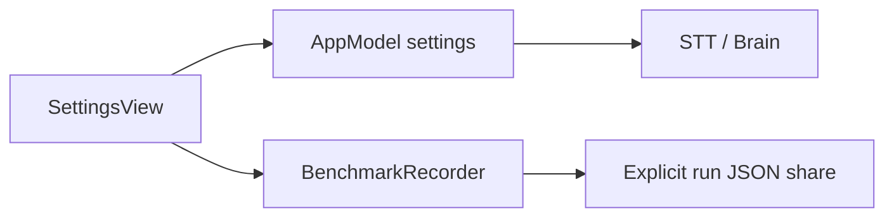

| File | What | Status |
|---|---|---|
| [SettingsView.swift](SettingsView.swift) | Native engine/brain/vocabulary/proxy settings; model preparation; recorder and share completion | 🟡 Apple compile/device **unverified** |
| [EnginePickerView.swift](EnginePickerView.swift) | Previous standalone task 7 debug picker; retained for upstream package link compatibility | 🟡 Superseded by SettingsView in app navigation |

Start with SettingsView. Purpose: task 6 settings/benchmark UI; inputs: Stt/Brain contracts and
SW/bench schema/sets; verification: syntax parse only. REQ-9–14/37/56; accuracy/battery/latency **unverified**.

Cross-review: local Bindable references avoid writable key paths through runtime lets.
Settings changes persist immediately to a protected private file; consent withdrawal
also stops active capture. Apple compilation remains **unverified**.
Share completion is explicitly Sendable and sends only a success Bool to MainActor;
UIKit callback arguments remain inside the callback. SDK compilation **unverified**.
