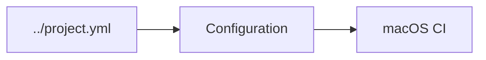

| File | What | Status |
|---|---|---|
| [AppGroup.entitlements](AppGroup.entitlements) | App Group shared by app and both extensions; ID expands from BUNDLE_ID_PREFIX. | ✅ Scaffold |
| [generate_icon.py](generate_icon.py) | Original microphone artwork, generated default/dark/tinted PNG variants; catalog is ignored | ✅ Linux generated |
| `Assets.xcassets/` | Three single-size 1024 PNGs; dark has transparency, tinted is grayscale | 🟡 Linux generated; Home Screen appearance **unverified** |
| `*-Info.plist` | Generated by XcodeGen; ignored | ✅ Generated only |

Start with the linked file; see the [iOS map](../README.md) for design and validation.

Run `python3 SW/ios/Configuration/generate_icon.py` from the repository root.
The generator is the artwork source; CI reproduces the ignored asset catalog.
Chosen PNG variants instead of an unvalidated handwritten Icon Composer package.
[Design decision and Apple source](../../../AI/SW/2026-11-04-liquid-glass-research.md#icon-choice).
No pre-rendered glass or reused icon artwork. Owner approval / Apple rendering **unverified**.
