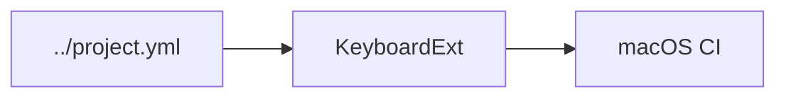

| File | What | Status |
|---|---|---|
| [KeyboardViewController.swift](KeyboardViewController.swift) | Keyboard switch button; full access disabled. | 🟡 macOS build unverified |

Start with the linked file; see the [iOS map](../README.md) for design and validation.
