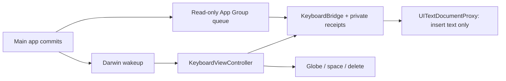

| File | What | Status |
|---|---|---|
| [KeyboardViewController.swift](KeyboardViewController.swift) | Status, drain on activation/notification/poll, globe/space/delete; no return key | 🟡 Apple compile/device **unverified** |
| [../Packages/KeyboardBridge/](../Packages/KeyboardBridge/README.md) | Text-only queue and persistent private receipt logic; no ML | ✅ Linux logic |

Start with the controller and [iOS keyboard notes](../README.md). Traces [REQ-16],
[REQ-46], [REQ-47]. No mic, network, host-field reading or audio. Full Access stays off:
current Apple guidance permits reading the shared group; the keyboard never writes there.
The status destination means the current caret, not an inspected host app/recipient.
Listening is the main app's last published capture state, not microphone use by the keyboard.

The app must publish and prune the queue; see the [producer contract](../Packages/KeyboardBridge/README.md).
For unsupported fields use explicit copy/share in the main app; app UI integration and
owner checks in Messages/Mail (including no auto-send) remain **unverified**.
