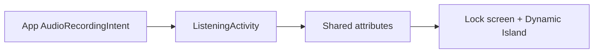

| File | What | Status |
|---|---|---|
| [ListeningAttributes.swift](ListeningAttributes.swift) | Shared recording status/destination, compiled into app and widget | 🟡 Apple CI **unverified** |
| [VoiceRemoteActivity.swift](VoiceRemoteActivity.swift) | Native listening/destination presentation | 🟡 Lock screen/device **unverified** |

Start with the app's [ListeningActivity](../App/ListeningActivity.swift).
Purpose: task 6 recording visibility; inputs: Apple ActivityKit/AudioRecordingIntent contract;
verification: syntax parse only. REQ-2/7. Intent cold-start and background reliability **unverified**.
Attributes and content state explicitly conform to Sendable. The app retains only
an activity ID; SDK handles are obtained inside nonisolated update/end operations.
Apple SDK compilation of this Swift 6 correction remains **unverified** pending CI.
