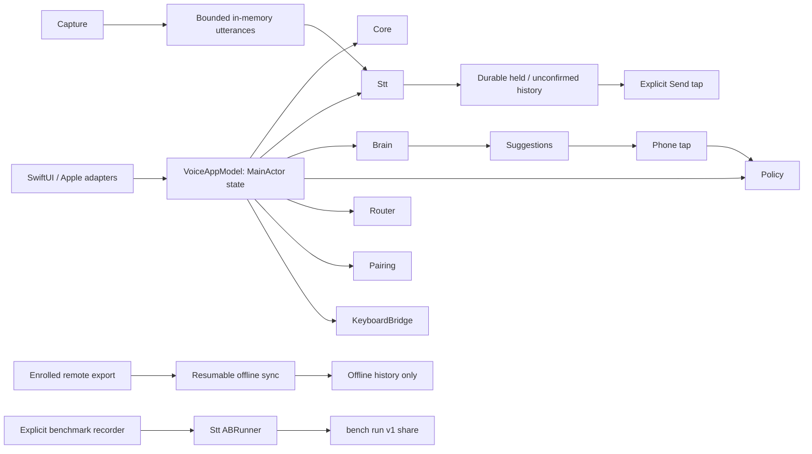

| Path | What | Status |
|---|---|---|
| [Sources/](Sources/README.md) | State, microphone cancellation, segmentation, text retention, review, recorder, BLE parsing/scoring | ✅ Synthetic Linux tests; Apple observation **unverified** |
| [Tests/](Tests/README.md) | Safety flows, interrupted segments, BLE vectors, schema export and audio deletion | ✅ Synthetic tests; no performance claim |
| [Package.resolved](Package.resolved) | Reproducible Crypto/ASN.1 dependency pins inherited from Pairing | ✅ Resolved on Linux |
| [Package.swift](Package.swift) | Plain Swift composition of seven merged packages and generated Protocol | ✅ Linux |

Start with [VoiceAppModel](Sources/AppModel.swift); Apple integration is in [App](../../App/README.md).
Sleep/wake, archive and BLE adapters: [source map](Sources/README.md), [integrity tests](Tests/PhoneAdaptersTests.swift), [signed transport tests](Tests/SignedPhoneTransportTests.swift). Real crypto is portable-tested; Apple/APNs/board execution remains **unverified**. Trace: REQ-29/32/34–35/49–55/61.
Purpose: task 6 app logic. Inputs: SYS design Modes/Control plane/Risks, product A–F/3.3/4.4/P0,
requirements, merged package contracts, bench schema and draft BLE contract. Verification:
synthetic tests only; no owner audio, device measurement, hardware or Apple compilation.
Traces REQ-2–8/12/16–18/23/28–33/38/46–52/56/60.

```sh
swift test -j 4 --package-path SW/ios/Packages/AppModel
swift test -j 4 --package-path SW/ios/Packages/Stt
```

| Decision / limit | Evidence or follow-up |
|---|---|
| Dictation path | AppModel pins the target before capture; Stt final → durable held history → literal insertion when reachable. Connection-generation changes also hold the utterance. Reconnect never sends held text; a history tap does. TaskStatus command_id maps to segment_id: unavailable means failed, error means unconfirmed. Successful sends stay unconfirmed. Oversized text splits and is journaled before encoding. No Brain call. Synthetic assertions. |
| Stop | Cancels current epoch, stops hardware even during async setup, clears partials and rejects late results. Completed history and independent tasks remain. |
| Continuous capture | One source, bounded PCM slices, silence/maximum-duration boundaries; a lost slice ends the source visibly. Heuristic 800 ms silence, amplitude 400 PCM units and 20 s maximum are **TBC**, not measured speech/battery/latency claims. First-word/negation quality **unverified**. |
| Segments | Interrupted segments never commit. Previously committed segments remain in history; visible recording status reports interruption (Core history has no interruption-status field). |
| Approval | Ambient input stays inferred. Local PTT context and explicit scoped target-selection grants are trusted settings inputs; sensitive delegation still requires exact-preview phone approval and fresh biometric/passcode. Remote approvals are disabled. Ambiguous wake remains inferred. |
| Observation | Apple builds use Observation; the portable `onStateChange` hook is tested on Linux with the same transitions and without the macro. Installed Linux Swift 6.2 Observation library has an unresolved runtime symbol; no link workaround or fake runtime is shipped. |
| Pairing | `ComputerPairing` wraps relay redemption/XX/phrase and LAN fallback. Complete desktop JSON code or base64 payload is accepted; relay v1 has no short-code lookup. Metadata/tombstones and keys survive relaunch; the app uses Pairing SessionResume at launch/reconnect. Portable crypto/restore tests pass; Apple Keychain/network behavior **unverified**. |
| Recorder | Explicit benchmark PCM writer; owner prompts bundled directly from SW/bench/sets. JSON uses validated BenchRun and the actual bench schema in tests. Successful share deletes PCM unless explicitly kept; cancelled share retains it for retry. Abandoned PCM removed on next recorder launch; kept files have `.kept` suffix. |
| Source quality | Deterministic SNR/clipping/proximity/dropout score; missing/invalid/lost streams rejected. Coefficients **TBC**; no synchronized multi-mic capture or measured source superiority claim. |
| BLE | Draft 1.1: same-major version rule, capability gates, status-bit compatibility, resumable list/fetch, CRC/frame validation, clock, durable short discard, delete after successful transcription + history; hardware codec/throughput/enrollment **unverified**. Authenticated enrollment must precede audio. |

Cross-review corrections: cancelled/failed HOLD requires a fresh press; Auto destination
changes publish listening presentation; exact Policy permits survive queue failure for
verified retry. RegisteredRouting feeds actual paired registry metadata into a real
TaskRouter; missing machine executors produce durable holds. Unsupported executors or
unknown pinned provider sessions report queue-confirmation failure, never a fictional hold.
Settings persistence is synchronous on change, including consent withdrawal. Core itself
needed no change: PeerStore restores only active metadata with a present Keychain key.
BLE reconnect regression: the first actual phone-state write requests an Input
snapshot, including when the unsolicited reconnect snapshot arrived before subscription.
Further writes request recovery until synchronized; reset restores the first-write rule.
Synthetic test reproduced the missing flag before the fix; BLE hardware **unverified**.

Offline sync temporarily persists private audio/metadata until successful STT, then removes audio. Completed IDs deduplicate retries; failed/ambiguous STT retains source and requires Retry; deliberate live preemption resumes automatically. Silent/oversized records remain visible for Discard without starving later records. Audio appends to per-record protected files; metadata contains no audio. Offline text never enters insertion or Brain. Capture provenance retains approximate UTC or unknown time with boot/tick, separately from receipt/retention time. Owner request (2026-11-02) overrides the draft's earlier-delete option. Evidence: [offline regressions](Tests/OfflineSyncTests.swift), [held regressions](Tests/HeldDictationTests.swift), and [real relay gate](../../../../SYS/tests/e2e/README.md). Apple execution remains **unverified**.

Cross-review: [RemoteEnrollment](Sources/RemoteEnrollment.swift) persists a pin only after protected access and explicit both-screen Numeric Comparison confirmation. CoreBluetooth lacks method/bond attestation; firmware enforcement and device verification remain **unverified**. Relay refusal suspends without deleting trust.

BenchmarkRecorder now supports per-capture clipping review, private in-memory WAV listening, controlled battery cohorts and optional correlated delivery/field annotations. Import the reviewed 50-command JSON before recording for spoken-command mode; its combined export includes A/B speech and Foundation Models proposals from recognized text. Mixed capture/engine cohorts are rejected. No benchmark call executes; native accuracy and field insertion remain **unverified**.

After a successful share, start a new cohort for another microphone or command set; source/engine/vocabulary changes never mix into the prior export.

REQ-56 privacy: history and task payloads default to seven days; held/failed/unconfirmed text instead shows a retention-review state and blocks Send until Keep/Delete is persisted. Keep renews seven days even if delivery then succeeds. `RetainedTaskStore` retains only hashes after payload expiry, without changing Router or audit authority. Offline sync clears duplicate text after history save, expires pending text after seven days and preserves the remote source for explicit Retry/Discard. Legacy un-timestamped pending text receives one seven-day migration interval. Benchmark exports expire after seven days; explicitly kept benchmark audio remains opt-in. Evidence: [privacy tests](Tests/PrivacyRetentionTests.swift), [offline tests](Tests/OfflineSyncTests.swift); Apple behavior **unverified**.
AI Control: [AgentControl](Sources/AgentControl.swift) authenticates inventory correlation and pins provider/project/workspace/session/profile. Live paired adapters dispatch retained Policy bytes, query receipts, hold offline work and cancel through fresh Policy permits. Restored queued tasks require exact-action review. PTT is local input context; armed/ambiguous wake stays inferred and never identifies a speaker. Command slices retain one transcript revision sequence with replaceable ambient cards before EOS. Linked successors require trusted completion; CLI replies confirm delivery only. See [regressions](Tests/AgentControlTests.swift) and [real relay gate](../../../../SYS/tests/e2e/README.md); Apple/device/provider execution is **unverified**.

Cross-review fixes and proof: [regressions](Tests/CrossReviewTests.swift), [live-socket registration](Sources/PhoneWake.swift). Production uses trigger-pinned capture factories, background-only resume and the current control-event BLE acknowledgement rule; source selection/labels never confer approval authority. Apple execution remains **unverified**.

AI Control audit closures: deliberate phone HOLD target selection can use an exact armed grant without a card; open ambient capture produces replaceable review hypotheses. Authenticated inventory feeds selected/recent/default routing and configured fallbacks, with changed-route reapproval. Linked tasks wait for an audited phone owner “This finished” event bound to task/session/operation. History/offline envelopes bind the installation account. See [tests](Tests/README.md); synthetic Linux evidence only, Apple/device/provider effects **unverified**.
