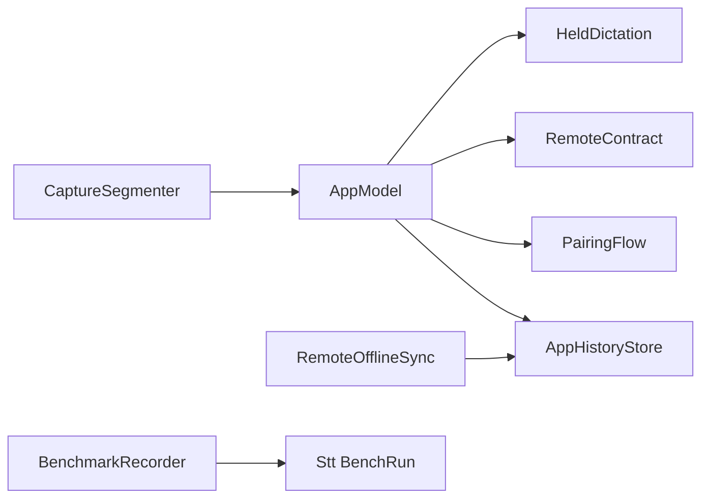

| File | What | Status |
|---|---|---|
| [AppLifecycle.swift](AppLifecycle.swift) | Portable route policy and shared cold-start runtime bootstrap | ✅ Linux regressions |
| [RegisteredRouting.swift](RegisteredRouting.swift) | Real paired-registry destinations, durable Router holds; no fabricated provider sessions | ✅ Real Router integration tests |
| [PeerStore.swift](PeerStore.swift) | Private enrollment/tombstone and synchronous settings persistence; restore into Core | ✅ Linux reopen tests; iOS Data Protection **unverified** |
| [PeerResume.swift](PeerResume.swift) | Fresh pinned Noise resume with encrypted readiness, matching desktop protocol | ✅ Synthetic cryptographic test; network/device **unverified** |
| [PeerRevocation.swift](PeerRevocation.swift) | Revoke notification, durable local removal and unconditional key cleanup | ✅ Linux synthetic failure test |
| [AppModel.swift](AppModel.swift) | Capture/mode/target composition, suggestions and Policy-only approval | ✅ Synthetic Linux tests |
| [AppHistoryStore.swift](AppHistoryStore.swift) | Atomic text + delivery state journal; held/unconfirmed/failed survive expiry until explicit delete | ✅ Synthetic Linux tests |
| [CaptureSegmenter.swift](CaptureSegmenter.swift) | Bounded in-memory continuous utterances | 🟡 Synthetic tests; speech thresholds **TBC** |
| [PairingFlow.swift](PairingFlow.swift) | Cancel-safe UI state and small ComputerPairing adapter protocol | 🟡 Package contracts; live transport **unverified** |
| [HeldDictation.swift](HeldDictation.swift) | Target/connection-generation pinning, Unicode-safe atomic split/hold, explicit resend, honest delivery outcomes | ✅ Linux restart/failure tests |
| [RemoteEnrollment.swift](RemoteEnrollment.swift) | Explicit Numeric Comparison confirmation, protected-access peripheral pin | ✅ Portable tests; OS attestation unavailable |
| [HistoryTextIdentity.swift](HistoryTextIdentity.swift) | Stable UUID for non-UUID history/chunk identifiers | ✅ Linux |
| [RemoteOfflineSync.swift](RemoteOfflineSync.swift) | Draft 1.1 clock/list/resume/CRC/transcribe/confirmed delete; append-only protected audio, per-record failure/discard, live-yield resume | ✅ Linux interruption/integrity/idempotency tests; BLE hardware **unverified** |
| [RemoteContract.swift](RemoteContract.swift) | Draft 1.1 info/input/audio/state parsing, same-major/capability compatibility, first-write snapshot recovery, fragmentation, source scoring | 🟡 Synthetic vectors; hardware **unverified** |
| [BenchmarkRecorder.swift](BenchmarkRecorder.swift) | Prompt reader, explicit private PCM store, A/B and export lifecycle | ✅ Synthetic schema/deletion tests; phone **unverified** |

Start with `VoiceAppModel`. Purpose/inputs/verification and REQ trace: [package map](../README.md).

BenchmarkRecorder adds optional measured stage offsets, battery cohort and clipping annotations, in-memory WAV playback, and 50-command import/export using recorded STT input. Command exports include speech results and proposal-only Brain results. Missing field acknowledgements remain TBD.
Delivery now persists authenticated positive outcomes; unconfirmed Send taps query before any resend. Remote capture is stop-only, with correlated refusals, bounded request ledgers, sequence checks and absolute/monotonic expiry. A remote start never opens the microphone. Unconfirmed Send remains visible unless a durable never-claimed query permits the same segment to send on that tap. REQ-16–18/21/27.

| Privacy store | Rule | Status |
|---|---|---|
| [RetainedTaskStore.swift](RetainedTaskStore.swift) | Seven-day disk payload/preview expiry; hashed command/idempotency tombstones; account validation; existing queue migration | ✅ Portable tests; Apple host **unverified** |
| [AppHistoryStore.swift](AppHistoryStore.swift) | Seven days; expired held text requires durable Keep/Delete; warning state blocks Send | ✅ Relaunch/dormant/choice tests |
| [RemoteOfflineSync.swift](RemoteOfflineSync.swift) | No transcript copy after history save; pending text expires; audio survives until STT | ✅ Synthetic recovery tests |
