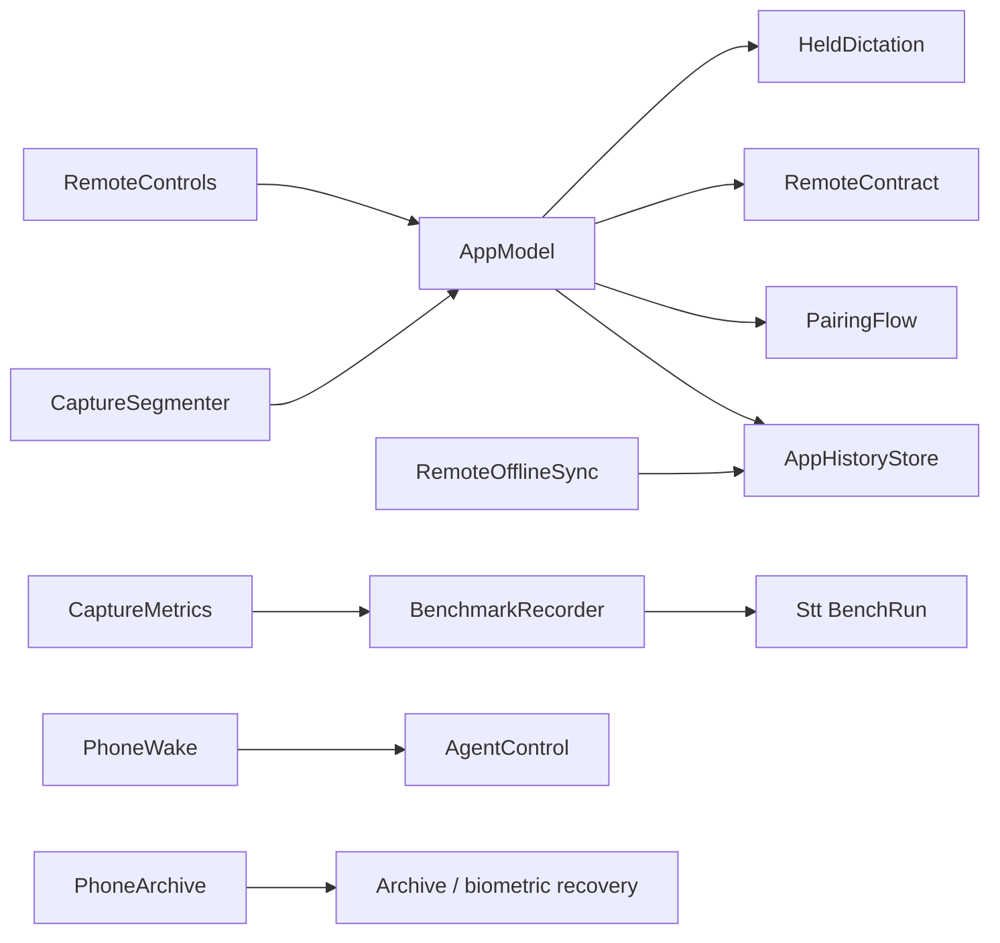

| File | What | Status |
|---|---|---|
| [AgentControl.swift](AgentControl.swift) | Paired inventory/identity, live Router targets, retained preview dispatch, status/query/cancel and revocation | ✅ Synthetic tests; Apple UI unverified |
| [PhoneWake.swift](PhoneWake.swift) | Fixed-hint validation; APNs token registration on the existing authenticated relay socket; retained intent for reconnect | ✅ Synthetic signed-byte checks; APNs **unverified** |
| [PhoneArchive.swift](PhoneArchive.swift), [ArchiveHTTP.swift](ArchiveHTTP.swift) | Real AES-GCM, exact member-signed HTTP, typed refusal mapping, bounded/no-redirect reads, biometric restore adapter | ✅ Portable crypto/transport/recovery; Apple HTTP **unverified** |
| [RemoteControls.swift](RemoteControls.swift) | Snapshot-safe PTT/mode/target edges, remote-tick short-press rejection, bounded provisional audio; no approval or lock | ✅ Synthetic transitions; BLE **unverified** |
| [CaptureMetrics.swift](CaptureMetrics.swift) | PCM envelope/clipping/interruption telemetry, recent-source selection, interruption-preserving capture wrapper | ✅ Portable tests; scoring **TBC**, proximity unknown |
| [AppLifecycle.swift](AppLifecycle.swift) | Portable route policy and shared cold-start runtime bootstrap | ✅ Linux regressions |
| [RegisteredRouting.swift](RegisteredRouting.swift) | Real paired-registry destinations, durable Router holds; no fabricated provider sessions | ✅ Real Router integration tests |
| [PeerStore.swift](PeerStore.swift) | Private enrollment/tombstone and synchronous settings persistence; restore into Core | ✅ Linux reopen tests; iOS Data Protection **unverified** |
| [PeerResume.swift](PeerResume.swift) | Fresh pinned Noise resume with encrypted readiness, matching desktop protocol | ✅ Synthetic cryptographic test; network/device **unverified** |
| [PeerRevocation.swift](PeerRevocation.swift) | Revoke notification, durable local removal and unconditional key cleanup | ✅ Linux synthetic failure test |
| [AppModel.swift](AppModel.swift) | Capture/mode/target composition, suggestions and Policy-only approval | ✅ Synthetic Linux tests |
| [AppHistoryStore.swift](AppHistoryStore.swift) | Atomic text + delivery state journal; held/unconfirmed/failed survive expiry until explicit delete | ✅ Synthetic Linux tests |
| [CaptureSegmenter.swift](CaptureSegmenter.swift) | Bounded in-memory continuous utterances | 🟡 Synthetic tests; speech thresholds **TBC** |
| [PairingFlow.swift](PairingFlow.swift) | Cancel-safe UI state and small ComputerPairing adapter protocol | 🟡 Package contracts; live transport **unverified** |
| [HeldDictation.swift](HeldDictation.swift) | Target/connection-generation pinning, Unicode-safe atomic split/hold, explicit resend, honest delivery outcomes | ✅ Linux restart/failure tests |
| [RemoteEnrollment.swift](RemoteEnrollment.swift) | Explicit Numeric Comparison confirmation, protected-access peripheral pin | ✅ Portable tests; OS attestation unavailable |
| [HistoryTextIdentity.swift](HistoryTextIdentity.swift) | Stable UUID for non-UUID history/chunk identifiers | ✅ Linux |
| [RemoteOfflineSync.swift](RemoteOfflineSync.swift) | Draft 1.1 clock/list/resume/CRC/transcribe/confirmed delete; append-only protected audio, per-record failure/discard, live-yield resume | ✅ Linux interruption/integrity/idempotency tests; BLE hardware **unverified** |
| [RemoteContract.swift](RemoteContract.swift) | Draft 1.1 info/input/audio/state parsing, same-major/capability compatibility, first-write snapshot recovery, fragmentation, source scoring | 🟡 Synthetic vectors; hardware **unverified** |
| [BenchmarkRecorder.swift](BenchmarkRecorder.swift) | Prompt reader, explicit private PCM store, A/B and export lifecycle | ✅ Synthetic schema/deletion tests; phone **unverified** |

Start with `VoiceAppModel`. Purpose/inputs/verification and REQ trace: [package map](../README.md).

BenchmarkRecorder adds optional measured stage offsets, battery cohort and clipping annotations, in-memory WAV playback, and 50-command import/export using recorded STT input. Command exports include speech results and proposal-only Brain results. Missing field acknowledgements remain TBD.
Delivery now persists authenticated positive outcomes; unconfirmed Send taps query before any resend. Remote capture is stop-only, with correlated refusals, bounded request ledgers, sequence checks and absolute/monotonic expiry. A remote start never opens the microphone. Unconfirmed Send remains visible unless a durable never-claimed query permits the same segment to send on that tap. REQ-16–18/21/27.

| Privacy store | Rule | Status |
|---|---|---|
| [RetainedTaskStore.swift](RetainedTaskStore.swift) | Seven-day disk payload/preview expiry; hashed command/idempotency tombstones; account validation; existing queue migration | ✅ Portable tests; Apple host **unverified** |
| [AppHistoryStore.swift](AppHistoryStore.swift) | Seven days; expired held text requires durable Keep/Delete; warning state blocks Send | ✅ Relaunch/dormant/choice tests |
| [RemoteOfflineSync.swift](RemoteOfflineSync.swift) | No transcript copy after history save; pending text expires; audio survives until STT | ✅ Synthetic recovery tests |

PairingFlow requires a separate explicit agent-access choice. AppModel retains command text across slices, carries linked dependencies, exposes restored review and exact scoped target-selection grant/revoke controls.

AgentControl uses a temporary immutable preview lookup per routing pass; task payload persistence remains with the host’s RetainedTaskStore.

RetainedTaskStore also filters live Router snapshots; an expired task cannot be selected from a stale queue to restore its text through a new approval.

Delegate review requires the user's selected provider/project/session. Approval aborts if Brain reports a dismissed/expired/stale card (including an open sheet after spoken cancel); cancellation reads current queue state. Provider replies stay in RetainedTaskStore with the original task expiry.

Wake invalidates old queued permits before inventory can release them; durable dispatched identities are queried without blind replay. Named-source recorder exports use a separate envelope because `BenchRun` currently excludes remote sources. Pending archive intents, read-back loss and fresh biometric recovery use the unchanged Policy v2 contract (REQ-29/32/34–35/54–55/61).

Cross-review: scene resume requires a prior background transition; Live Activity failures are presentation-only. Capture factories pin at the trigger (including HOLD press) before suspension; remote triggers never borrow local PTT authority. BLE arming accepts the modulo interval from latest control event through latest Input; status snapshots need no new acknowledgement. Empty legacy audit journals can initialize a missing checkpoint; marked or nonempty missing-anchor history fails closed.

| AI Control path | Entry / boundary |
|---|---|
| Scoped HOLD | `AppModel.submitExplicitTarget`: exact target-selection grammar, pinned device/project, live grant; no Brain authority |
| Ambient review | `TranscriptSegment.hypothesis`: incomplete slices stay inferred; corrections cancel unqueued reviews/permits |
| Production routes | `AgentControl.routingRules` + `plan`: authenticated inventory, persisted selection/recency/default/orders; machine ownership pins the chosen local route after priority resolution; per-action cloud independence clears after enqueue/restart |
| Owner completion | `reviewTaskCompletion` → `confirmTaskFinished`: exact task/session/operation card; sealed evidence and audited receipt; provider replies never prove success |
| Account records | `AppHistoryStore` / `RemoteOfflineSync`: version-2 account envelopes; validate whole input before use and migrate legacy data under the pin |

An exact known offline local route remains reviewable as an explicit durable hold; its preview says it will wait. Availability is never rewritten for review, and only the same approved provider session can release it on reconnect.

`CaptureSegmenter` carries silence/limit/end boundaries into bounded `CaptureIntentBuffer` revisions. Independent speech preserves earlier approvals/offline tasks; corrections invalidate only their unfinished intent. AI slices retain the displayed approved target. `ProviderOrderDraft` preserves typed commas; approval route descriptions label cloud fallback as new execution.
