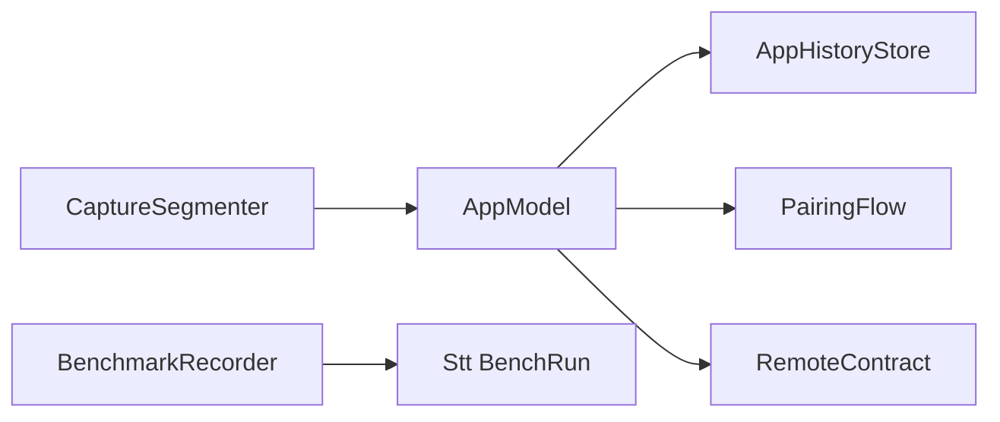

| File | What | Status |
|---|---|---|
| [AppLifecycle.swift](AppLifecycle.swift) | Portable route policy and shared cold-start runtime bootstrap | ✅ Linux regressions |
| [RegisteredRouting.swift](RegisteredRouting.swift) | Real paired-registry destinations, durable Router holds; no fabricated provider sessions | ✅ Real Router integration tests |
| [PeerStore.swift](PeerStore.swift) | Private enrollment/tombstone and synchronous settings persistence; restore into Core | ✅ Linux reopen tests; iOS Data Protection **unverified** |
| [PeerResume.swift](PeerResume.swift) | Fresh pinned Noise resume with encrypted readiness, matching desktop protocol | ✅ Synthetic cryptographic test; network/device **unverified** |
| [PeerRevocation.swift](PeerRevocation.swift) | Revoke notification, durable local removal and unconditional key cleanup | ✅ Linux synthetic failure test |
| [AppModel.swift](AppModel.swift) | Capture/mode/target composition, suggestions and Policy-only approval | ✅ Synthetic Linux tests |
| [AppHistoryStore.swift](AppHistoryStore.swift) | Private text-only file, seven-day retention, delete | ✅ Synthetic Linux tests |
| [CaptureSegmenter.swift](CaptureSegmenter.swift) | Bounded in-memory continuous utterances | 🟡 Synthetic tests; speech thresholds **TBC** |
| [PairingFlow.swift](PairingFlow.swift) | Cancel-safe UI state and small ComputerPairing adapter protocol | 🟡 Package contracts; live transport **unverified** |
| [RemoteContract.swift](RemoteContract.swift) | Draft BLE info/input/audio/state parsing, first-write snapshot recovery, fragmentation, source scoring | 🟡 Synthetic vectors; hardware **unverified** |
| [BenchmarkRecorder.swift](BenchmarkRecorder.swift) | Prompt reader, explicit private PCM store, A/B and export lifecycle | ✅ Synthetic schema/deletion tests; phone **unverified** |

Start with `VoiceAppModel`. Purpose/inputs/verification and REQ trace: [package map](../README.md).
