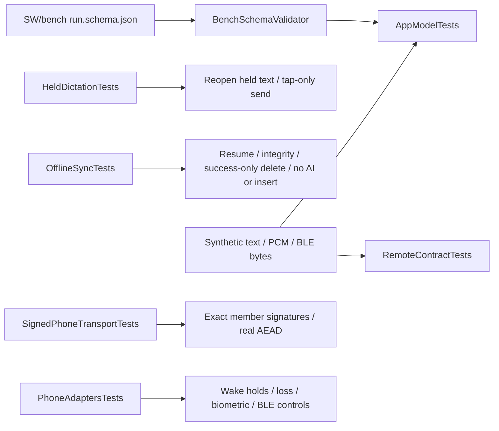

| File | What | Status |
|---|---|---|
| [PresentationTests.swift](PresentationTests.swift) | Every tool/enum/category label, Home state matrix, microphone preview and real settings persistence for consent on/off | ✅ Portable synthetic tests; native interaction **unverified** |
| [CrossReviewTests.swift](CrossReviewTests.swift) | Background-only reconciliation, REC restart gating, target/PTT ordering, held-PTT snapshot acknowledgement/wrap, trigger source pinning, presentation failure, empty-journal migration and Apple source wiring | ✅ Portable behavior/source checks; Apple SDK **unverified** |
| [PhoneAdaptersTests.swift](PhoneAdaptersTests.swift) | AEAD nonce/AAD/key mutation, durable read-back loss, denied/accepted/crash-resumed biometric recovery, content-free wakes, BLE tick wrap/snapshots/source loss and remote tier 3 refusal | ✅ Portable synthetic boundaries |
| [SignedPhoneTransportTests.swift](SignedPhoneTransportTests.swift) | Real Ed25519 proofs over exact production adapter bytes, uncertain append retry with identical ciphertext, read-back/typed writer refusal and APNs registration metadata | ✅ In-memory transport; service **unverified** |
| [IntegrationReviewTests.swift](IntegrationReviewTests.swift) | Remote pin/reopen/revoke, segment status mapping, suspension retaining keys, stable chunk IDs | ✅ Linux |
| [HeldDictationTests.swift](HeldDictationTests.swift) | Restart/long retention, changed connection generation, unreachable target, tap-only send, failed/unconfirmed insertion, oversized Unicode split | ✅ Linux |
| [OfflineSyncTests.swift](OfflineSyncTests.swift) | Interrupted fetch resume, lost delete ACK, CRC/structure, STT/history failure, explicit retry after ambiguous STT, short discard, version/capability/enrollment gates, offline text/clock provenance, per-record failure/discard, live-yield resume and linear 1 MiB writes | ✅ Linux synthetic |
| [ReviewRegressionTests.swift](ReviewRegressionTests.swift) | Press/cancel, scene transitions, PairingFlow, consent persistence, real Router and BLE presentation budget | ✅ Linux regressions |
| [PeerLifecycleTests.swift](PeerLifecycleTests.swift) | Persistence → Core restore, pinned Noise resume, key mismatch, revoke cleanup and confirmation | ✅ Synthetic Linux |
| [AppModelTests.swift](AppModelTests.swift) | Dictation isolation, destination order, stop, Policy biometrics, remote refusal, history and recorder | ✅ Linux synthetic |
| [RemoteContractTests.swift](RemoteContractTests.swift) | Draft small-MTU vectors, reconnect snapshot requests, fragment rejection, input loss, source scoring, segmentation | ✅ Linux synthetic |
| [BenchSchemaValidator.swift](BenchSchemaValidator.swift) | Existing Stt offline schema helper, validates actual authoritative run v1 | ✅ Linux synthetic |

Start with `swift test -j 4 --package-path SW/ios/Packages/AppModel`.
Purpose: regression evidence; inputs: invented fixtures and actual bench schema; verified only
on Linux. REQ-4/5/8/12/16/18/28/29/31/32/50/56. No real transcripts/audio/credentials.

Cross-review fixes: first reproduced failed-HOLD auto-retry, stale Auto presentation,
and consumed approval retry with failing tests; then repaired those transitions.
No real transcripts, audio or keys. Apple adapter behavior and CI remain **unverified**.

| [BenchmarkRecorderTests.swift](BenchmarkRecorderTests.swift) | Synthetic clipping/battery export and 50-recording command-to-proposal integration | ✅ Linux synthetic tests; device **unverified** |
Delivery regressions cover positive outcome authentication/restart, remote-start refusal from OFF, late/stale stop rejection, and tap-only same-ID resend after certified never-claimed queries. Remote requests never start synthetic capture. Capture and field adapters are synthetic.

| [PrivacyRetentionTests.swift](PrivacyRetentionTests.swift) | Legacy history migration, dormant/relaunch expiry, durable held-text review, task payload expiry/replay tombstones, consent withdrawal, benchmark-export expiry | ✅ Portable synthetic tests; REQ-56 |

OfflineSyncTests additionally checks pending transcript expiry, removal of the duplicate text before remote deletion acknowledgement, and retention of source on failed STT/cancellation. HeldDictationTests verifies that expired Send requires a retention choice.
[AgentControlTests.swift](AgentControlTests.swift) covers actor/request/connection spoofing, explicit capabilities, exact workspace/profile, offline release, authenticated status, changed profile holds, predecessor refusal, restart review and revoked old permits. AppModelTests covers correction text across silence slices without early inference.

AgentControl retention regression uses the real RetainedTaskStore, expires an offline task, reconnects, and verifies that neither disk payload restoration nor agent dispatch occurs.

Review regressions cover model-selected sessions without user choice, a dismissed/open review, spoken cancellation of an open linked review, stale held-task cancellation and dispatched app replies holding successors.

The socket fake enforces same-device replacement and destructive queue drain, matching `SW/relay/src/room.ts`. Repeated wake registration stays on the existing socket; reconnect automatically submits retained registration. Nonempty or previously marked journals without checkpoints remain recovery/loss cases.

| AI Control regression | Evidence |
|---|---|
| [AIControlGapTests.swift](AIControlGapTests.swift) | Positive grant-only HOLD; wrong/revoked/ambiguous scope and sensitive LA; open-capture cards, correction after queue failure; account migrations/rejections |
| [AgentControlTests.swift](AgentControlTests.swift) | Two authenticated hosts/providers plus cloud: explicit/selected/recent/default, local/cloud fallback, held machine/named targets, actual replacement approval/dispatch; owner-observed file fixture, completion binding, stale/reconnect/cancellation negatives and linked phone workflow |

These prove synthetic policy/routing behavior. The scoped result-file fixture is checked independently before the simulated owner tap; live provider effects and SwiftUI execution remain **unverified**.

Review regressions reproduce independent-speech cancellation, cumulative-text capture failure, cross-target grant failure, mid-capture destination reset, ordinary “session timeout” rejection and editable provider commas. Intent tests cover committed-intent separation, unfinished correction/continuation identity and full-context negation. Production cloud approval asserts the new-execution label.

Home presentation includes Stop while preparing; the state-matrix regression covers all capture/listening combinations. Apple rendering remains **unverified**.

Presentation helpers provide sentence headings for every tool and instruction-only
agent task titles, keeping exact payloads unchanged. Portable formatter tests
cover all tool cases; native mockup matching remains **unverified**.
