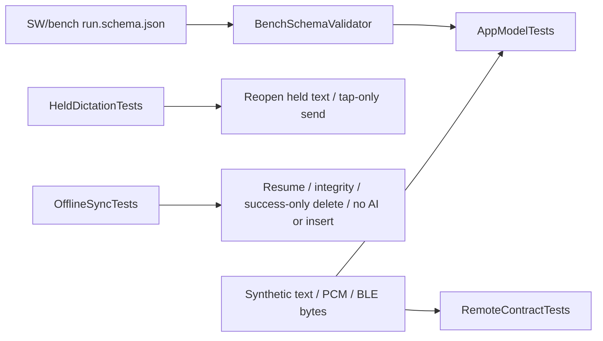

| File | What | Status |
|---|---|---|
| [IntegrationReviewTests.swift](IntegrationReviewTests.swift) | Remote pin/reopen/revoke, segment status mapping, suspension retaining keys, stable chunk IDs | ✅ Linux |
| [HeldDictationTests.swift](HeldDictationTests.swift) | Restart/long retention, changed connection generation, unreachable target, tap-only send, failed/unconfirmed insertion, oversized Unicode split | ✅ Linux |
| [OfflineSyncTests.swift](OfflineSyncTests.swift) | Interrupted fetch resume, lost delete ACK, CRC/structure, STT/history failure, explicit retry after ambiguous STT, short discard, version/capability/enrollment gates, offline text/clock provenance, per-record failure/discard, live-yield resume and linear 1 MiB writes | ✅ Linux synthetic |
| [ReviewRegressionTests.swift](ReviewRegressionTests.swift) | Press/cancel, scene transitions, PairingFlow, consent persistence, real Router and BLE presentation budget | ✅ Linux regressions |
| [PeerLifecycleTests.swift](PeerLifecycleTests.swift) | Persistence → Core restore, pinned Noise resume, key mismatch, revoke cleanup and confirmation | ✅ Synthetic Linux |
| [AppModelTests.swift](AppModelTests.swift) | Dictation isolation, destination order, stop, Policy biometrics, remote refusal, history and recorder | ✅ Linux synthetic |
| [RemoteContractTests.swift](RemoteContractTests.swift) | Draft small-MTU vectors, reconnect snapshot requests, fragment rejection, input loss, source scoring, segmentation | ✅ Linux synthetic |
| [BenchSchemaValidator.swift](BenchSchemaValidator.swift) | Existing Stt offline schema helper, validates actual authoritative run v1 | ✅ Linux synthetic |

Start with `swift test -j 4 --package-path SW/ios/Packages/AppModel`.
Purpose: regression evidence; inputs: invented fixtures and actual bench schema; verified only
on Linux. REQ-4/5/8/12/16/18/28/29/31/32/50/56. No real transcripts/audio/credentials.

Cross-review fixes: first reproduced failed-HOLD auto-retry, stale Auto presentation,
and consumed approval retry with failing tests; then repaired those transitions.
No real transcripts, audio or keys. Apple adapter behavior and CI remain **unverified**.

| [BenchmarkRecorderTests.swift](BenchmarkRecorderTests.swift) | Synthetic clipping/battery export and 50-recording command-to-proposal integration | ✅ Linux synthetic tests; device **unverified** |
Delivery regressions cover positive outcome authentication/restart, remote-start refusal from OFF, late/stale stop rejection, and tap-only same-ID resend after certified never-claimed queries. Remote requests never start synthetic capture. Capture and field adapters are synthetic.

| [PrivacyRetentionTests.swift](PrivacyRetentionTests.swift) | Legacy history migration, dormant/relaunch expiry, durable held-text review, task payload expiry/replay tombstones, consent withdrawal, benchmark-export expiry | ✅ Portable synthetic tests; REQ-56 |

OfflineSyncTests additionally checks pending transcript expiry, removal of the duplicate text before remote deletion acknowledgement, and retention of source on failed STT/cancellation. HeldDictationTests verifies that expired Send requires a retention choice.
