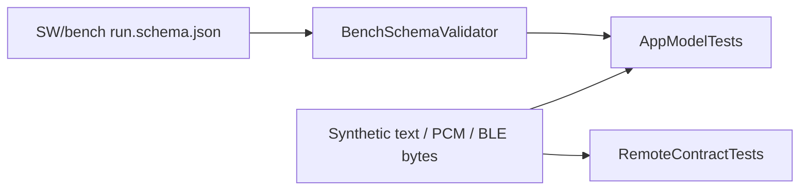

| File | What | Status |
|---|---|---|
| [ReviewRegressionTests.swift](ReviewRegressionTests.swift) | Press/cancel, scene transitions, PairingFlow, consent persistence, real Router and BLE presentation budget | ✅ Linux regressions |
| [PeerLifecycleTests.swift](PeerLifecycleTests.swift) | Persistence → Core restore, pinned Noise resume, key mismatch, revoke cleanup and confirmation | ✅ Synthetic Linux |
| [AppModelTests.swift](AppModelTests.swift) | Dictation isolation, destination order, stop, Policy biometrics, remote refusal, history and recorder | ✅ Linux synthetic |
| [RemoteContractTests.swift](RemoteContractTests.swift) | Draft small-MTU vectors, fragment rejection, input loss, source scoring, segmentation | ✅ Linux synthetic |
| [BenchSchemaValidator.swift](BenchSchemaValidator.swift) | Existing Stt offline schema helper, validates actual authoritative run v1 | ✅ Linux synthetic |

Start with `swift test -j 4 --package-path SW/ios/Packages/AppModel`.
Purpose: regression evidence; inputs: invented fixtures and actual bench schema; verified only
on Linux. REQ-4/5/8/12/16/18/28/29/31/32/50/56. No real transcripts/audio/credentials.

Cross-review fixes: first reproduced failed-HOLD auto-retry, stale Auto presentation,
and consumed approval retry with failing tests; then repaired those transitions.
No real transcripts, audio or keys. Apple adapter behavior and CI remain **unverified**.
