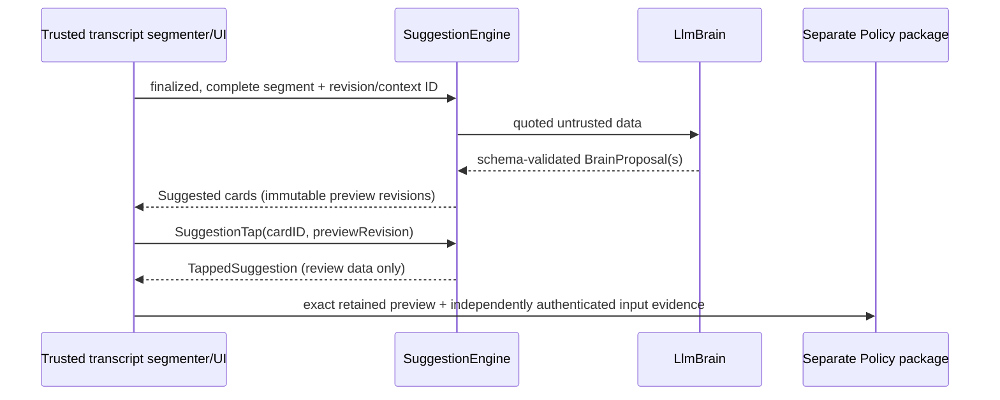

| Boundary | Contract / initial assumption |
|---|---|
| Purpose / inputs | Task 10; SYS design Modes/Control plane/Plugins, product Journeys C/D + §4/§7, requirements, generated Protocol and bench run-v1 |
| Verification | Linux synthetic tests and fake HTTP only; Apple compilation, live providers, on-device quality and app integration **unverified** |
| Authority | Proposal has only generated `ToolCall`; unknown tools, input keys, account mismatches and invalid values are dropped/countable. Unknown provider envelope/block metadata is ignored, never promoted to authority. Malformed documents count once. No raw command or approval decoder exists. |
| Tap | Only `tap` changes a reviewable card to Approved. The returned snapshot has no actor, activation, credential, scope or execution method. `SuggestionTap` is UI plumbing, **not** an authenticated event or permission. |
| Policy handoff | Policy independently authenticates input, retains exact preview bytes/hash, checks risk, actor, account, target, grants, expiry and dependencies, and constructs commands. Brain does not depend on Policy. |
| States | Suggested → Edited/Approved/Dismissed/Expired. Execution states after Approved belong to Policy/executor. Approval replay and edits after approval are rejected. |
| Incremental data | Caller supplies increasing revisions and final/complete flags. Partial/incomplete segments never invoke inference. Only a segment's own revision invalidates its inference; mute/context changes invalidate all. Inference sees the entire final text once, including later corrections and ordinary ambient context sentences. |
| Dependencies | A narrow sentence/“then”/imperative heuristic marks linked plans. The model receives the whole utterance and returns zero or more final proposals, not one mandatory tool per sentence. Linked outputs retain sequential dependencies and a local `planID`; ambient outputs remain independent. Lists are review plans, never queues. |
| Cancellation | “cancel the second one”, including the configured wake prefix, locally dismisses that plan's second pending card and expires its dependent tail. Unrelated suggestions never replace plan ordinals. UI can name a `planID`; speech selects the most recent linked plan. Cancellation of submitted commands belongs to Policy with a known `cancel_task` ID. |
| Dedupe / rate / expiry | Natural-language instructions normalize case/whitespace for comparison; IDs, URIs, recipients and send contents stay exact. Original payload never changes. Dismissed/approved intents stay deduped until expiry. Defaults: three cards per 30 seconds, 120-second lifetime; all **TBC**, configurable defensive assumptions. Linked batches are rate limited atomically. |
| Resource bounds | Reserve an inference slot and attempt budget before calling a provider: default eight requests per rate window, at most four in flight. No-output and failed attempts count. Default caps: 256 retained cards and 256 segment-revision records, pruned after their lifetimes; revisions beyond this bounded history are forgotten. Plan bookkeeping follows retained cards. Segment ID/context ID ≤128 characters, transcript ≤16,384. Defaults are defensive assumptions, **TBC**. Deferred work returns `rateLimited`, `busy` or `capacity`; no automatic retry queue exists. |
| Meeting mute / wake tokens | Mute hides cards and suppresses inference. Wake phrases match whole whitespace tokens; only trailing `,:;.!?` punctuation is removable from the final wake token. Possessives, hyphenated references, single/double quoted speech, uncertain speaker, meeting and playback downgrade to suggestion evidence. No punctuation-only token can substitute for the start of a command. Phrase defaults to “Assistant”, **TBC**. |
| Router | Hybrid default: narrow simple open/switch/select path on device, multi-step/ambient cloud; offline/cloud errors explicitly report on-device degradation. `BrainResponse` and `SuggestionUpdate.routingNotice.message` preserve this notice through generic interfaces. Cloud-only offline throws; unavailable local models throw. Results never claim execution. |
| Refusal / text output | HTTP-200 refusal is a distinct `BrainOutcome.refused`: no proposals, no on-device retry, and a “Request refused” label. `stop_reason`, refusal `stop_details`, and refusal blocks all take precedence over proposed tools. Fenced JSON/prose is dropped, never extracted as a tool call. |
| Proxy | Full HTTPS proxy URL supplied by host; no direct Anthropic URL, query credentials or provider-key API. Host injects authenticated relay-session transport; relay owns provider credentials. Proxy implementation/auth integration **unverified**, out of scope. Redirects, caching and cookies disabled. |
| Benchmark | `BrainBenchmark.writeRun` exports run-v1 JSON to caller's private URL, with synthetic flag and named device/model/version. Failed inference records empty calls. No tool execution/logging. Battery absent = TBD; phone measurement **unverified**. Never commit owner exports. |

Provider documentation checked **2026-11-02**:

| Official source | Used here |
|---|---|
| [Messages reference](https://platform.claude.com/docs/en/api/messages) | `POST /v1/messages`; relay forwards the Messages-shaped body; configurable model defaults to `claude-opus-5-5` and API version to `2026-10-21` |
| [Define tools](https://platform.claude.com/docs/en/agents-and-tools/tool-use/define-tools) | Named client tools with JSON `input_schema` |
| [Handle tool calls](https://platform.claude.com/docs/en/agents-and-tools/tool-use/handle-tool-calls) | Read `tool_use` blocks with `id`, `name`, `input`; stop before execution, never feed fictitious tool results back |
| [Create a Message](https://platform.claude.com/docs/en/api/http/messages/create), [stop reasons](https://platform.claude.com/docs/en/build-with-claude/handling-stop-reasons) | Checked response metadata including `stop_details`, `diagnostics` and `caller`; metadata remains outside strict tool-input validation. Refusal is a separate outcome; this product does not automatically fall back on refusal. |

Live compatibility and prompt-injection resistance of model reasoning remain **unverified**.
The tested guarantee is structural: any accepted output remains a proposal and cannot confer authority.
