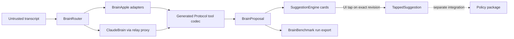

| Path | What | Status |
|---|---|---|
| [Package.resolved](Package.resolved) | Crypto/ASN.1 dependency pins for relay signing | ✅ Linux resolved |
| [Package.swift](Package.swift) | Plain Swift 6 + Protocol/Pairing signing dependencies; no Policy/Core dependency | ✅ Linux |
| [Sources/](Sources/README.md) | Strict tool inputs, tolerant provider metadata, refusal outcomes, bounded whole-transcript suggestions | ✅ Synthetic Linux tests |
| [Tests/](Tests/README.md) | Authority, current-shape fake server, refusal, streaming races, retention/rate caps and cancellation | ✅ Linux |
| [INTEGRATION.md](INTEGRATION.md) | Policy handoff, assumptions, provider sources and verification limits | 🟡 Integration pending |

Start with [LlmBrain](Sources/LlmBrain.swift), then [SuggestionEngine](Sources/SuggestionEngine.swift).
Run `swift test -j 4 --package-path SW/ios/Packages/Brain`; scoped: append `--filter Suggestion`.
Trace: [REQ-31/33/36–40](../../../../SYS/requirements.md). Tests prove portable behavior only.
Live Claude, Apple/MLX, real-device accuracy/latency/battery, visible app cards and Policy integration are **unverified**.

Fenced JSON in model text stays **dropped**, never parsed into a tool call. Claude accepts only
native `tool_use.input` through the generated codec; Apple/MLX text must be a bare JSON array.
Provider metadata is ignored. A refusal produces no proposals and never reruns on another brain.

Signed relay access uses [RelayBrainTransport](Sources/RelayBrainTransport.swift) around the final Messages body. The app derives the room route from persisted pairing and exposes deployment model/API-version settings. Linux tests and [real local relay gate](../../../../SYS/tests/e2e/README.md) verify body signing; live Anthropic and Apple host execution remain **unverified**.

Measurement update ([REQ-15], [REQ-39]): Claude HTTP reads reject oversized headers/chunks before accumulating more than 1 MiB. BrainBenchmark supports 50 recorded commands with separate expected prompts, recognized transcripts and recording IDs; real-source exports require spoken provenance. Benchmark proposals are never executed. Native/provider/device measurements remain **unverified**.
