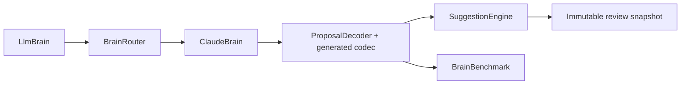

| File | What | Status |
|---|---|---|
| [LlmBrain.swift](LlmBrain.swift) | Non-executable proposals, distinct refusal outcome, requests and resource prompts | ✅ Linux |
| [ProposalDecoder.swift](ProposalDecoder.swift) | Bounded JSON envelope reader; original tool bytes to generated codec | ✅ Authority/grammar tests |
| [BrainRouter.swift](BrainRouter.swift) | On-device/Hybrid/Cloud; visible offline and failure degradation | ✅ Linux |
| [ClaudeBrain.swift](ClaudeBrain.swift) | Normalized relay-only HTTPS hosts; evolving metadata ignored, tool inputs closed | ✅ Current-shape fake server; live **unverified** |
| [SuggestionEngine.swift](SuggestionEngine.swift) | Whole finalized utterances, segment-local invalidation, plan ordinals, bounded state/inference, edit and tap | ✅ Linux |
| [CommandSequence.swift](CommandSequence.swift) | Conservative linked instructions and ordinal cancellation | ✅ Linux |
| [WakePhraseDetector.swift](WakePhraseDetector.swift) | Configured phrase; ambiguous/meeting/playback → suggestion evidence | ✅ Text tests; acoustic behavior **unverified** |
| [BrainBenchmark.swift](BrainBenchmark.swift) | Run-v1 JSON export without execution/logging | ✅ Synthetic tests; phone bench **unverified** |
| [Resources/](Resources/README.md) | Untrusted-data prompt + tool-schema snapshot | ✅ Bundled |
| [BrainAvailability.swift](BrainAvailability.swift) | Existing shell configuration flag | ✅ Linux |

Start with the interface; [integration contract](../INTEGRATION.md). Trace: REQ-31/33/36–40.
