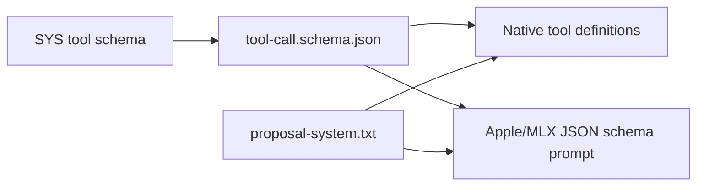

| File | What | Status |
|---|---|---|
| [proposal-system.txt](proposal-system.txt) | Static instructions; quoted untrusted data; whole-transcript corrections supersede earlier requests | ✅ Injection/data-boundary tests; live reasoning **unverified** |
| [tool-call.schema.json](tool-call.schema.json) | Exact SYS schema snapshot; runtime inlines Identifier for providers | ✅ Generated codec validates every output |

Start with the prompt. Trace: REQ-31/36. Keep the snapshot byte-identical to
`SYS/tools/tool-call.schema.json`; the generated Protocol codec remains authoritative.
Provider compliance/accuracy is **unverified**; prompts cannot grant authority.
