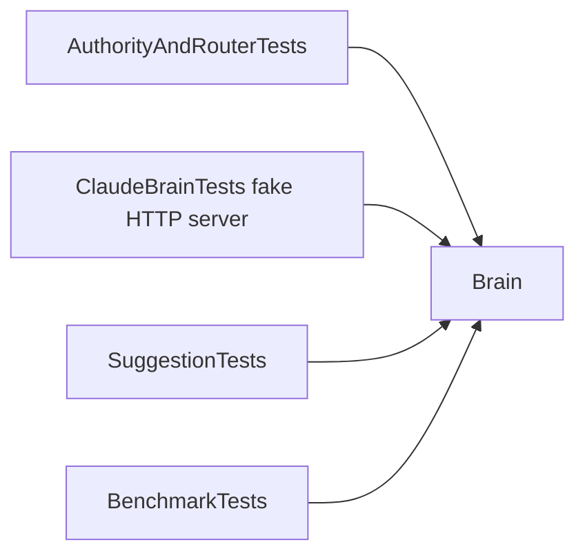

| File | What | Status |
|---|---|---|
| [AuthorityAndRouterTests.swift](AuthorityAndRouterTests.swift) | Forbidden fields, grammar, injection data, all router settings, wake ambiguity | ✅ Linux |
| [ClaudeBrainTests.swift](ClaudeBrainTests.swift) | Current response metadata, URLSession fake server, refusal without fallback, system/data separation, fenced-text rejection | ✅ Linux; live **unverified** |
| [StreamingRegressionTests.swift](StreamingRegressionTests.swift) | Journey C, full-text corrections, per-segment invalidation, plan-local cancellation, memory/inference limits | ✅ Linux |
| [SuggestionTests.swift](SuggestionTests.swift) | Tap-only approval, revision races, edit binding, mute, dedupe, limits, expiry, cancel second of three | ✅ Linux |
| [BenchmarkTests.swift](BenchmarkTests.swift) | Synthetic export; engine failures yield empty calls | ✅ Linux |
| [TestSupport.swift](TestSupport.swift) | Invented tool data and actor fakes; no real transcripts | ✅ Test support |
| [BrainTests.swift](BrainTests.swift) | Existing shell configuration flag test | ✅ Linux |

Start with authority tests. `swift test -j 4 --package-path SW/ios/Packages/Brain --filter Suggestion`.
Full suite: omit the filter. Trace: REQ-31/33/36–40. No accuracy, latency or battery claim follows from fixtures.
