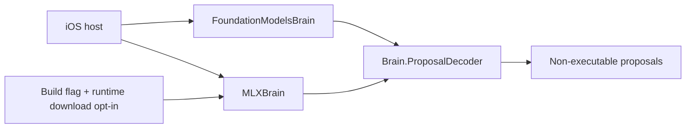

| Path | What | Status |
|---|---|---|
| [Package.swift](Package.swift) | Apple platforms; Brain; optional pinned MLX dependency | 🟡 CI compilation **unverified** |
| [Sources/](Sources/README.md) | Foundation Models and MLX adapters; no executable tools | 🟡 Device behavior **unverified** |
| [Tests/](Tests/README.md) | Runtime download requires explicit opt-in | 🟡 Apple CI **unverified** |

Start with the Foundation Models adapter. Trace: REQ-31/36/37/39.
XcodeGen links this package into the host to compile adapters in the coordinator's `ios-ci-*` run.
No app UI or default model activation is installed here.

MLX is disabled by default. Set `VOICE_REMOTE_ENABLE_MLX=1` **when resolving/building** this
package to link `mlx-swift-lm` **3.32.3** (Swift 6.2+), `swift-huggingface` **0.9.0** and
`swift-transformers` **1.3.0**, as in the [upstream integration guide](https://github.com/ml-explore/mlx-swift-lm/blob/3.32.3/README.md).
Then supply a reviewed model ID and
`MLXBrainConfiguration(allowOnDemandDownload: true)` to allow first-use loading/download.
No model is selected or downloaded automatically. Model licensing/size/quality checks and both
MLX-enabled compilation and on-device inference remain **unverified**.

Sources checked 2026-11-02: [Apple response API](https://developer.apple.com/documentation/foundationmodels/languagemodelsession/respond%28to%3Aoptions%3A%29),
[MLX pinned manifest](https://github.com/ml-explore/mlx-swift-lm/blob/3.32.3/Package.swift),
[model factory](https://github.com/ml-explore/mlx-swift-lm/blob/3.32.3/Libraries/MLXLMCommon/ModelFactory.swift),
[chat session](https://github.com/ml-explore/mlx-swift-lm/blob/3.32.3/Libraries/MLXLMCommon/ChatSession.swift).
