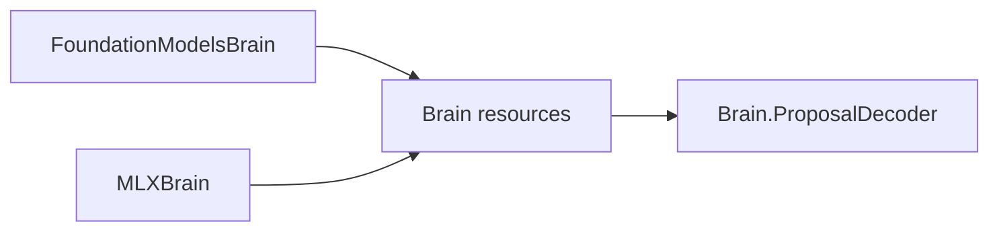

| File | What | Status |
|---|---|---|
| [FoundationModelsBrain.swift](FoundationModelsBrain.swift) | Availability check; fresh text-only session; strict proposals | 🟡 Apple CI/device **unverified** |
| [MLXBrain.swift](MLXBrain.swift) | Optional open model download on demand, fresh text-only session | 🟡 Flag-enabled CI/device **unverified** |

Start with Foundation Models. Trace: REQ-31/36/37. No native executable tool callbacks are registered.
Both paths use the same resource prompt, schema and generated-codec proposal decoder as Claude.
