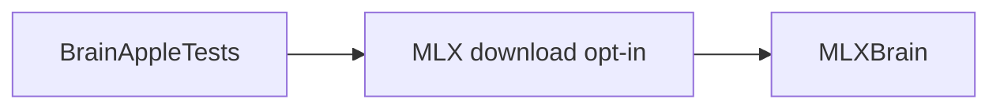

| File | What | Status |
|---|---|---|
| [BrainAppleTests.swift](BrainAppleTests.swift) | No download without runtime opt-in | 🟡 Apple CI **unverified** |

Start with the test. Trace: REQ-37. Coordinator can run `swift test -j 4 --package-path SW/ios/Packages/BrainApple`
on macOS. Actual model inference, Foundation Models availability and MLX-enabled builds remain **unverified**.
