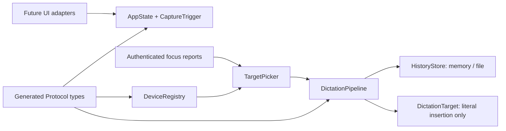

| Path | What | Status |
|---|---|---|
| [Package.swift](Package.swift) | iOS 26 minimum; Protocol dependency; no Brain or Apple frameworks | ✅ Linux tested |
| [Sources/](Sources/README.md) | State, triggers, routing, retention, registry and dictation | ✅ Unit tested |
| [Tests/](Tests/README.md) | Rules, boundary conditions, safety and suspension races | ✅ Linux tested |

Start with [AppState](Sources/AppState.swift), then [DictationPipeline](Sources/DictationPipeline.swift).
Run `swift test -j 4 --package-path SW/ios/Packages/Core`.
Trace: REQ-3/4/5/8, REQ-16/17/18, REQ-25, REQ-56/60.

| Integration obligation / assumption | Decision |
|---|---|
| Trigger ambiguity in REQ-8 | Two taps each <300 ms with a ≤500 ms release-to-press gap lock; one tap does nothing. Holds ≥300 ms are PTT and clear the pending tap. Window configurable; UI drives `advance` from a monotonic timer. |
| Auto clock and phone | Stamp authenticated reports on receipt with `FocusClock` (phone monotonic uptime); peer timestamps never order/expire reports. The local phone is always eligible, even without registry enrollment. |
| First word destination | Await `prepare` and its presentation acknowledgment before starting STT; commit uses the pinned device. |
| Account/device authority | Feed authenticated focus reports; register only after both pairing confirmations, before installing the peer key. Duplicate IDs are rejected. To replace or restore an ID, complete `revoke`, perform a fresh pairing, then call explicit `rePair` before installing the new key. Pending/failed key cleanup blocks re-pair. |
| Revocation | Remove locally first; attempt key deletion and room leave even if one fails. Adapter serializes actual insertion with credential/session revocation. |
| Dictation whitespace | Replace runs of line separators with one space, trim, remove all remaining schema controls; empty segments produce no history entry or insertion. |
| Delivery failure | Save history before insertion. Surface errors; do not blindly retry the same segment. No exactly-once delivery claim. |
| Retention | Purge on append/read/open and explicit `purge`; UI schedules purge at startup and while idle. Seven days is the current REQ-56 default. |
| File privacy | One actor per file; owner-only temporary file and atomic replacement; startup removes a crash-orphaned pending file. Apple file protection/backup policy is a UI adapter obligation. |

Phone capture, remote/tray presentation, key storage, network delivery and on-device behavior remain **unverified**.

REQ-56: [InstallationAccount](Sources/InstallationAccount.swift) resolves the legacy account once and rejects a different requested account after pinning. The Apple host persists the pin in Keychain; Keychain/device behavior is **unverified**. [Regression](Tests/LogicTests.swift).
