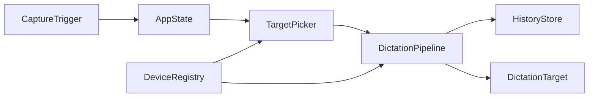

| File | What | Status |
|---|---|---|
| [AppIdentity.swift](AppIdentity.swift) | Product display name | ✅ Tested |
| [AppState.swift](AppState.swift) | Independent mode/capture/target; 300 ms PTT threshold and short-double-tap lock | ✅ Tested |
| [TargetPicker.swift](TargetPicker.swift) | Named device or Auto with a 60-second phone-monotonic receipt window; unconditional local fallback | ✅ Tested |
| [DeviceRegistry.swift](DeviceRegistry.swift) | Account-bound roles/capabilities; duplicate-ID rejection, revocation and explicit re-pair | ✅ Tested |
| [HistoryStore.swift](HistoryStore.swift) | Text-only in-memory and private atomic file stores; 7-day purge | ✅ Tested |
| [DictationPipeline.swift](DictationPipeline.swift) | Expose/pin target, preserve line boundaries as spaces, drop empty text, save and insert literal text | ✅ Tested |

Start with `AppState.swift`. Requirements and adapter obligations: [package map](../README.md).

TargetPicker ranks native input age plus phone monotonic elapsed time. Missing age is inactive, disconnect clears focus, and idle heartbeats cannot reset the 60-second activity window.

| [InstallationAccount.swift](InstallationAccount.swift) | Single-account migration/pin policy; changed account fails closed before private storage opens | ✅ Portable relaunch/switch tests; REQ-56 |
