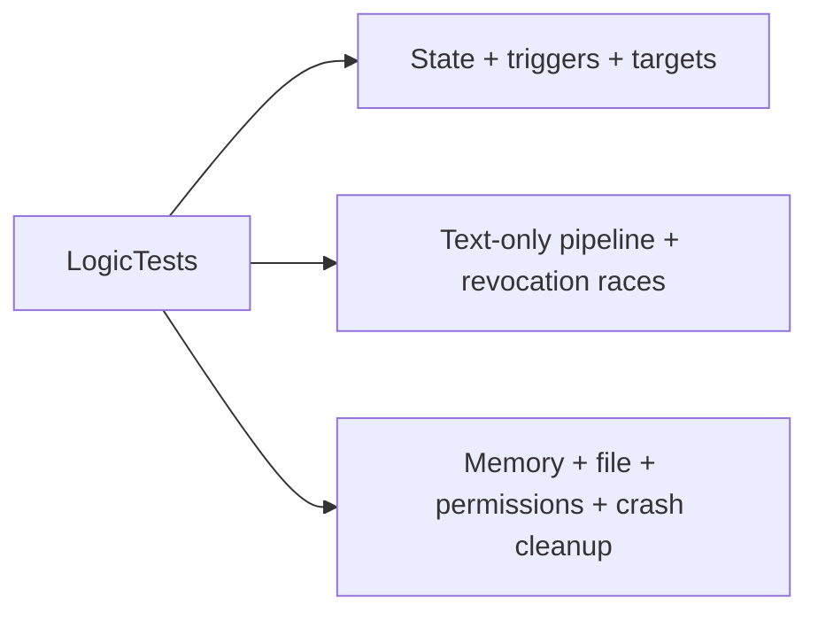

| File | What | Status |
|---|---|---|
| [CoreTests.swift](CoreTests.swift) | Display-name default | ✅ Linux tested |
| [LogicTests.swift](LogicTests.swift) | Every control/routing/retention rule; scalar sanitization (CRLF/control + combining marks); no Brain dependency; gated presentation/revocation/re-pair; crash-orphan cleanup; short taps vs holds; skewed focus clocks; unregistered phone; whitespace/empty segments; iOS 26 declarations | ✅ Linux tested |

Start with `LogicTests.swift`. Run the [package command](../README.md).
All text is synthetic; no audio or real transcripts are used.

CRLF, embedded CRLF and controls followed by combining marks exercise the existing scalar
sanitation path. No Core source change was needed. Apple behavior is **unverified** pending CI.

Auto regressions compare two devices with extreme peer-clock skew, idle heartbeats beyond 60 seconds, unknown age and disconnect clearing. No physical focus sample is claimed.

`LogicTests.InstallationAccountTests` covers legacy/default resolution, relaunch and refusal of changed/missing account settings after pinning (REQ-56). No real account credentials.
