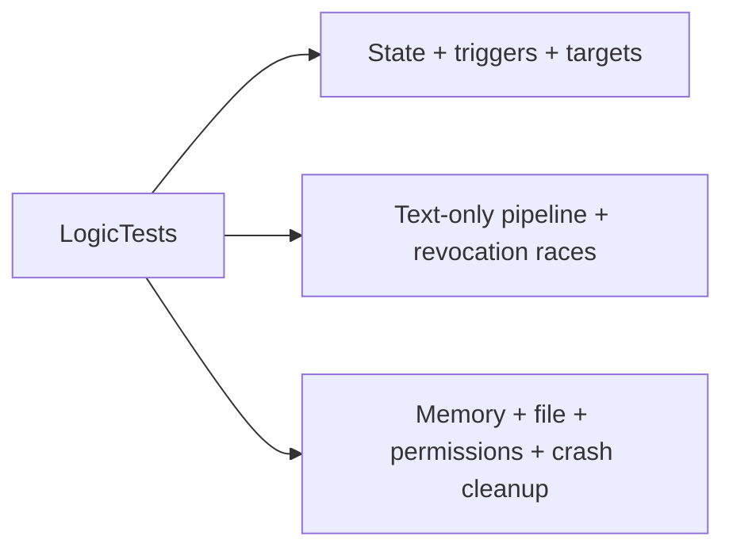

| File | What | Status |
|---|---|---|
| [CoreTests.swift](CoreTests.swift) | Display-name default | ✅ Linux tested |
| [LogicTests.swift](LogicTests.swift) | Every control/routing/retention rule; schema sanitization; no Brain dependency; gated presentation/revocation/re-pair; crash-orphan cleanup; short taps vs holds; skewed focus clocks; unregistered phone; whitespace/empty segments; iOS 26 declarations | ✅ Linux tested |

Start with `LogicTests.swift`. Run the [package command](../README.md).
All text is synthetic; no audio or real transcripts are used.
