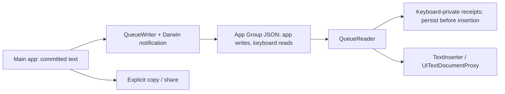

| Path | What | Status |
|---|---|---|
| [Package.swift](Package.swift) | Plain Swift library; UIKit fallback conditionally compiled | ✅ Linux |
| [Sources/](Sources/README.md) | Queue, policy, crash receipts, notification and fallback APIs | ✅ Portable logic tested; Apple adapters **unverified** |
| [Tests/](Tests/README.md) | Synthetic text only: ordering, crash recovery, expiry, limits, no Send | ✅ Linux |

Start with `QueueWriter.enqueue` and `QueueReader.drain` in
[KeyboardBridge.swift](Sources/KeyboardBridge.swift). Traces [REQ-16], [REQ-46],
[REQ-47], [REQ-48], [REQ-56]; real-device compliance remains **unverified**.
Run `swift test -j 4 --package-path SW/ios/Packages/KeyboardBridge` (via `heavy` on hwgeekom).

| Contract | Behavior |
|---|---|
| File | `keyboard-queue-v1.json`: version=1, listening Boolean, segments array in commit order; JSONEncoder dates are seconds since 2001-01-01 UTC |
| Segment | UUID `id`, Date `createdAt`, String `text`; committed text only, never audio or partials |
| Ownership | Main app writes shared file atomically under writer lock; keyboard only reads it and writes receipts in its private Application Support directory |
| Deduplication | Same ID is one immutable commitment; retry with original ID and timestamp. Queue order is append order, independent of timestamp |
| Crash behavior | Persist and fsync receipt + directory before insertion; crash in the gap loses text. No automatic retry of a claimed ID. UIKit has no transactional insertion acknowledgment |
| Concurrency | Separate file locks serialize app writers and keyboard drains; drain holds its lock through insertion; inserter must not reenter drain |
| Limits | 256 KiB encoded queue/ledger, 1,024 records, 16 KiB UTF-8 per segment; full queue rejects new text without replacing last good file |
| Interrupted write | One fixed `.pending` file per queue/ledger, bounded to the same byte cap; removed on the next locked operation. No unbounded temporary files |
| Retention | Seven days, exclusive expiry boundary; future segments rejected. App calls `maintain` at launch and periodically, including when idle; no iOS background deletion guarantee |
| Receipts | Only UUID/time, retained seven days; capacity failure stops insertion. Persistent private ledger required; deleting app/ledger voids deduplication |
| Validation | Writer and reader reject controls and all newline scalars, including Unicode line/paragraph separators; corrupt/unknown/oversized files stop delivery |
| Notification | Darwin name `com.voiceremote.keyboard.queue-changed.v1`, no payload; wakeup hint only. Activation and polling recover missed hints |

App integration (owned by the main-app task): link this package to the app, resolve
`group.<BUNDLE_ID_PREFIX>`, and construct `QueueWriter(sharedDirectory:)`. Publish only
committed iPhone-target segments with stable IDs/timestamps; call `maintain(listening:)`
on capture state changes and periodically. Keep history for explicit recovery when a
claim is lost or capacity is reached. Do not delete receipts or rewrite retries as new IDs.

For unsupported fields, offer explicit history actions using `CommittedTextFallback.copy`
(local-only clipboard with original seven-day expiry) and `.shareSheet` (present from the
main app, anchor its popover on iPad). Sharing leaves the app under user control; recipients
and pasted copies control their own retention. App buttons/presentation are **unverified**
and outside this task's ownership. The extension cannot appear in fields/apps that reject it.
