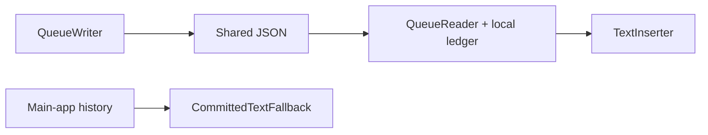

| File | What | Status |
|---|---|---|
| [KeyboardBridge.swift](KeyboardBridge.swift) | Bounded text-only queue, validation, receipts and Darwin post | ✅ Linux logic; Darwin **unverified** |
| [CommittedTextFallback.swift](CommittedTextFallback.swift) | Explicit main-app copy and share APIs | 🟡 Apple compile/device **unverified** |

Start with the [package contract](../README.md); traces [REQ-16], [REQ-46–48], [REQ-56].

QueueReader persists a separate shared success receipt only after insertText returns. QueueWriter reads that receipt for reconciliation; enqueue and the pre-call dedup ledger cannot imply delivery.
