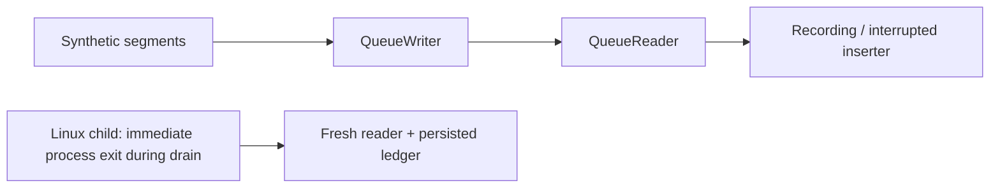

| File | What | Status |
|---|---|---|
| [KeyboardBridgeTests.swift](KeyboardBridgeTests.swift) | Ordering, ID dedup, crash gaps/process termination, expiry, caps, corrupt files, scalar CRLF/control-cluster rejection before queue and drain | ✅ Linux |

Start with `testNoSendRejectsAllControlsAndNewlinesBeforeQueueAndAtDrain` ([REQ-16])
and `testProcessTerminationMidDrain`. See the [package](../README.md) for the command.
UIKit Send behavior in Messages/Mail remains **unverified** ([REQ-46]).

CRLF, embedded CRLF and control + combining-mark regressions reject both writer input and
corrupted on-disk queue contents before insertion. BridgePolicy already uses scalar checks;
no bridge source change was needed. Apple execution remains **unverified** pending CI/device checks.
