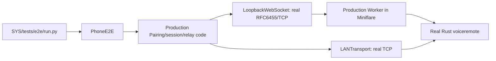

| File | Purpose / inputs | Status |
|---|---|---|
| [PhoneE2E.swift](PhoneE2E.swift) | Synthetic QR on stdin; human-confirmation coordination, dictation, resume, queued old-session message, outgoing revoke and permanent relay refusal | ✅ Linux E2E |
| [LoopbackWebSocket.swift](LoopbackWebSocket.swift) | Real RFC6455 upgrade, masking, ping/pong and bounded frame reader; loopback only | ✅ actual Worker |
| [SocketStream.swift](SocketStream.swift) | Real loopback TCP with cancellation and bounded I/O waits | ✅ WS + LAN |

Start: `bash SYS/tests/e2e/run.sh` at repo root. REQ-22–25/61 and plan task 2.
These are real socket clients, with no mock relay or fake transport. Linux's
WebSocket client is explicit because Foundation/libcurl WebSocket availability
varies; Apple production uses `URLSessionWebSocketConnector`, whose execution is
**unverified** here. The only substituted product boundary is the explicitly
requested synthetic desktop `TextInjector`, gated by the `e2e-test` build feature.
Keys and QR/token stay in memory or private temporary storage; output contains
fixed event names. Temporary processes/storage are removed on exit.

PhoneE2E uses production LAN framing, PreferredConnection and PhoneConnection for prepare/outcome/query. It tests max Unicode, positive/failure outcomes, Auto age/skew and LAN-to-relay fallback. CapturedTransport injects one synthetic stale encrypted packet solely to test receiver replay rejection.
