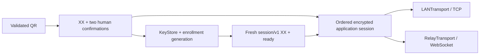

| Path | What | Status |
|---|---|---|
| [Package.swift](Package.swift) / [Package.resolved](Package.resolved) | iOS 26; pinned swift-crypto and generated Protocol | ✅ Linux compiled |
| [Sources/](Sources/README.md) | Pairing, resume, fragments, relay join/auth, LAN, key storage | ✅ Linux tests; Apple adapters unverified |
| [E2E/](E2E/README.md) | Actual socket phone client for the SYS real Worker/CLI gate | ✅ Linux |
| [Tests/](Tests/README.md) | Shared SYS vectors, negative tests, real Rust/Swift process exchange | ✅ Linux |

Start: [PairingConnection.swift](Sources/PairingConnection.swift), then
[ApplicationSession.swift](Sources/ApplicationSession.swift).
Trace: REQ-22–25/60/61; [authoritative wire profile](../../../../SYS/protocol/noise.md).

```sh
export CLANG_MODULE_CACHE_PATH=/tmp/voiceremote-clang-cache
export SWIFTPM_MODULECACHE_OVERRIDE=/tmp/voiceremote-swift-cache
export HEAVY_CPUS=4
heavy swift test -j 4 --package-path SW/ios/Packages/Pairing
# Real process pair; Rust is built automatically with cargo -j4:
heavy swift test -j 4 --package-path SW/ios/Packages/Pairing --filter NoiseInteropTests
```

Run from the repository root. Host tests need cargo and Python 3. No test skips.
[Interop details and real local gate](../../../../SYS/protocol/noise.md#phone-session-and-process-interop).

| Integration step | Trusted caller responsibility |
|---|---|
| Keys | Retain one `DeviceKeys` and one `PeerRegistry` over `KeychainStore`. In-memory fake is for tests. Keychain uses AfterFirstUnlockThisDeviceOnly for locked background audio/session work; explicit synchronizable=false excludes iCloud sync. `noiseKey()` persists X25519; `relayKey(account:room:)` and `relayDeviceID(account:room:)` create/persist a separate per-room Ed25519 identity. |
| First pair | A lost join response is recovered by a signed member connect with the same retained key/ID. For expired/aborted Noise enrollment, authenticate with that membership, revoke self, then scan a fresh QR. Parse QR with `PairingInvitation`. Build `RelayClient` with that room's relay identity and `URLSessionRelayHTTP` / `URLSessionWebSocketConnector`; `redeem` once, then `connect`. LAN uses `LANTransport` with `NetworkLANStream`. |
| Confirmation | Initiate XX; trusted UI compares both phrases and calls `confirmLocal`; `receiveConfirmation`, then `finish(registry:)`. No automatic confirmation or model authority. |
| Application | `ApplicationSession.send/receive` validates strict `InnerMessage` and nested accounts. 11,000-byte encrypted packets; ordered `03` fragments, 2 MiB bound, 90-second whole-message receive deadline. No executor or insertion adapter in this package. |
| Reconnect | Close the failed session/transport; `RelayClient.reconnect(registry:peer:)` surfaces permanent refusals without deleting enrollment; the host suspends routing on 403 and retains keys; transient failures back off 500 ms → 30 s and reports `droppedFrames`. Load enrollment with `lookup(publicKey:)`, then `SessionResume.initiate`. Do not retry an uncertain write. Dropped frames mean incomplete delivery, never insertion success. |
| Path switch | Serialize sends/receives. An already-authenticated ApplicationSession can mark a new carrier as retained state and preserve nonce order. Fresh pairing/reconnect uses the two-socket epoch and fresh XX; those handshakes ignore retained-state records. Concurrent readers/writers on a direction are rejected. A failed path requires fresh resume; old packets are never replayed. |
| Revoke | Delete enrollment through `PeerRegistry.revoke`; generation checks reject old sessions even after re-enrollment. Authenticated incoming revoke addressing this phone deletes the sender enrollment and closes the session. Relay membership removal is separate: signed `RelayClient.revoke`. |

Raw `NoiseXX`/`NoiseSession` are cryptographic primitives, not enrollment APIs.
Synthetic Rust/Swift interop proves handshake, phrase, both confirmations,
maximum Unicode fragments in both directions, resume, and revoke from either side.
Real iPhone networks, Apple Keychain/Network execution, native WebSocket upgrade
headers and deployed relay pairing remain **unverified**. The real local gate now verifies the merged Worker with corrected desktop
and phone clients. Run `bash SYS/tests/e2e/run.sh`; it also tests persisted stale
queue replay, real WebSocket/TCP resume, insertion and permanent refusal.

Cloud adapters share [RelayProxy](Sources/RelayProxy.swift): fresh context-checked challenges, exact Messages bytes, ordered WHATWG form query bytes (including literal plus/apostrophe/Unicode), same-room route checks and proof headers. [Real local gate](../../../../SYS/tests/e2e/README.md) proves both speech vendors and Claude through the production Worker. Complete desktop JSON pairing codes and base64 copies are supported; a short-code resolver is absent from relay v1.

User-requested relay cleanup uses `RelayMembershipCleanup`: peer 403 never skips self-revoke. An HTTP response is not an authenticated endpoint revocation.

PhoneConnection is the shared app/e2e request and outcome seam; PreferredConnection chooses LAN before relay at connect/resume, without retrying text. The e2e executable also exercises the real Core Auto picker.
