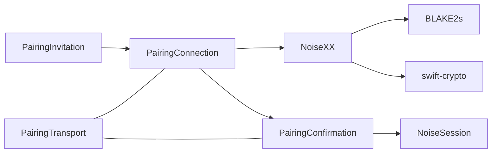

| File | What | Status |
|---|---|---|
| [BLAKE2s.swift](BLAKE2s.swift) | RFC 7693 BLAKE2s-256; HMAC and two-output Noise HKDF | ✅ RFC + boundary vectors |
| [NoiseXX.swift](NoiseXX.swift) | Three-message XX; actor-owned cipher streams; authentication, bounds and low-order DH checks | ✅ Cacophony vector |
| [PairingInvitation.swift](PairingInvitation.swift) | Validated QR, trusted-time/account/key checks; desktop prologue and four-word phrase | ✅ Tested |
| [PairingConnection.swift](PairingConnection.swift) | Phone initiator, QR pin, deadline, two confirmations and enrollment result | ✅ Tested |
| [Transport.swift](Transport.swift) | Frame transport protocol and bounded cancellable in-memory pair | ✅ Tested |

Start with `PairingConnection.swift`; [wire profile and integration obligations](../README.md).
