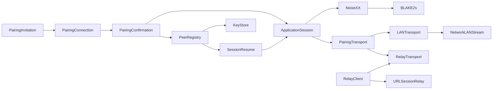

| File | What | Status |
|---|---|---|
| [BLAKE2s.swift](BLAKE2s.swift) | BLAKE2s-256, Noise HMAC/HKDF | ✅ RFC + boundary vectors |
| [NoiseXX.swift](NoiseXX.swift) | XX; noncopyable nonce streams, low-order DH rejection; authentication failure permanently closes | ✅ Cacophony + SYS vectors |
| [PairingInvitation.swift](PairingInvitation.swift) | Strict QR, account/key/time checks, pair prologue and phrase | ✅ Linux |
| [PairingConnection.swift](PairingConnection.swift) | QR pin, deadline, mandatory local/remote confirmation; registry finish | ✅ Linux + real Rust peer |
| [ApplicationSession.swift](ApplicationSession.swift) | `03` fragments; strict reassembly/accounts; generation checks; resume `02` ready | ✅ Negative + bidirectional Rust tests |
| [KeyStore.swift](KeyStore.swift) | KeyStore protocol, memory fake, persisted separate identities/enrollment; conditional Keychain | ✅ Memory; Keychain unverified |
| [Transport.swift](Transport.swift) | Common frame boundary and cancellable in-memory pair | ✅ Linux |
| [LANTransport.swift](LANTransport.swift) | u32-BE TCP framing and private-address policy; conditional Network TCP adapter with keepalive | ✅ Framing/policy; Network unverified |
| [RelayRecords.swift](RelayRecords.swift) | VRR1 two-socket freshness challenge; retained Noise path mode; filters old records before fresh XX | ✅ Replay fake + real Worker queue |
| [RelayClient.swift](RelayClient.swift) | Server-clock challenges, recoverable join, permanent refusals, reconnect/backoff, dropped reports and WS heartbeat | ✅ Independent signed fake |
| [URLSessionRelay.swift](URLSessionRelay.swift) | Bounded HTTP, no redirects, cancellable native WebSocket upgrade/ping | ✅ Linux HTTP loopback; native WS unverified |

Start: `PairingConnection.swift`; [integration obligations and commands](../README.md).
REQ-22–25/60/61. No action execution or model-controlled authorization fields.
