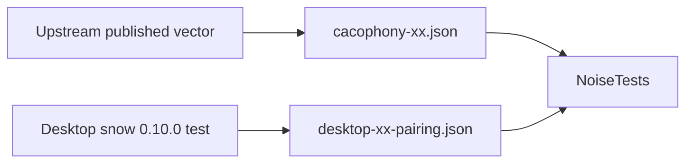

| File | What | Status |
|---|---|---|
| [desktop-xx-pairing.json](desktop-xx-pairing.json) | Snapshot of desktop-generated profile, confirmation and application vectors | ✅ Byte-exact test |
| [cacophony-xx.json](cacophony-xx.json) | Exact XX/25519/ChaChaPoly/BLAKE2s record, including public test-only private keys | ✅ Byte-exact test |

Source: [Cacophony vectors](https://github.com/haskell-cryptography/cacophony/blob/master/vectors/cacophony.txt),
file blob SHA-1 `b8a271ed1aba8b4a56bf429e559d7947827123b4`.
Selection: `protocol_name == "Noise_XX_25519_ChaChaPoly_BLAKE2s"`; no values changed.
These are published synthetic test keys, never production credentials.
Hash expectations in `NoiseTests.swift` come from [RFC 7693 Appendix B](https://www.rfc-editor.org/rfc/rfc7693#appendix-B)
and the [BLAKE2 official unkeyed KAT](https://github.com/BLAKE2/BLAKE2/blob/master/testvectors/blake2-kat.json)
(lengths 0, 3, 64, 65, 255).

Desktop snapshot source: `SYS/protocol/vectors/noise/xx-pairing.json` in sibling
worktree `codex-feat-desktop-core`, generated by
`SW/desktop/crates/core/tests/vectors.rs::published_xx_pairing_vector_matches`
with snow 0.10.0. The fixed private-key bytes 11/22/33/44 and token 55 are
synthetic public test material. The shared-vector loader checks the authoritative
copy too when it lands on the integration base.
