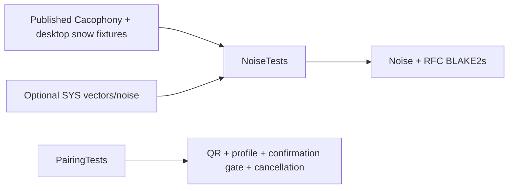

| File / folder | What | Status |
|---|---|---|
| [NoiseTests.swift](NoiseTests.swift) | Byte-exact Cacophony and desktop profile handshake/confirmations/application; RFC hash and block boundaries; tamper, replay, reflection, all-zero DH and limits | ✅ Linux tested |
| [PairingTests.swift](PairingTests.swift) | QR/clock/profile; CRLF/control-cluster key rejection; two confirmations; malformed/negative/cross-account/duplicate confirmations; cancellation and timeout | ✅ Linux tested |
| [Fixtures/](Fixtures/README.md) | Published synthetic Cacophony XX and desktop snow pairing vectors | ✅ Bundled |

Start with `NoiseTests.swift`. `testSharedSYSNoiseVectorsWhenPresent` loads
`SYS/protocol/vectors/noise/*.json` once available; absent directory is an explicit skip.
Recognized formats: Cacophony `vectors` envelope, individual XX object, or desktop
`xx-pairing.json` profile (raw JSON plaintext bytes, never reserialized).
[Run command](../README.md). All key material is published fixture data or generated in memory.

QR key/token regressions inject CRLF, embedded CRLF and control + combining-mark sequences.
Pairing already delegates to the generated codec and verifies canonical base64; no pairing
source change was needed. Apple execution is **unverified** until coordinator CI/device checks.
