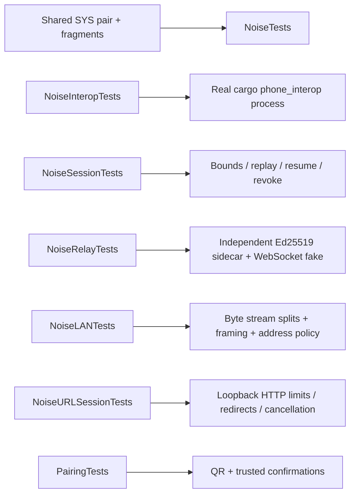

| File / folder | Evidence | Status |
|---|---|---|
| [NoiseTests.swift](NoiseTests.swift) | Byte-exact Cacophony + SYS pair/fragment vectors; phrase, confirmations, BLAKE2s, replay/reflection/low-order DH | ✅ Linux; required SYS files, no skips |
| [NoiseEpochTests.swift](NoiseEpochTests.swift) | Fake replays full old handshake/application/retained-state queues on connect; fresh XX succeeds; real adapters retain a live Noise state across ordered carrier changes | ✅ Linux |
| [NoiseInteropTests.swift](NoiseInteropTests.swift) | Live Rust desktop core: pairing, phrase, max Unicode each direction, resume, revoke from each endpoint | ✅ Two independent process pairs |
| [NoiseSessionTests.swift](NoiseSessionTests.swift) | Fragment grammar/bounds/UTF-8 split, deadline/cancel, accounts, revocation generation, key persistence, confirmed legacy enrollment migration, invalid resume | ✅ Linux |
| [RelayCleanupTests.swift](RelayCleanupTests.swift) | Peer 403 still attempts self-revoke and surfaces self-removal failure | ✅ Linux |
| [NoiseRelayTests.swift](NoiseRelayTests.swift) | Signed join/challenge/connect/revoke, clock skew, lost-response recovery, permanent refusals retain enrollment, exact proxy body/canonical-query hashes, complete-code parsing, wrong-route rejection, hostile responses, dropped count, retry cap/cancel, frame routing, ping deadline | ✅ Linux independent fake |
| [NoiseLANTests.swift](NoiseLANTests.swift) | Split/coalesced TCP frames, max packet, EOF/invalid lengths, private IP policy | ✅ Linux |
| [NoiseURLSessionTests.swift](NoiseURLSessionTests.swift) | Real loopback HTTP, streaming/declared response caps, redirect refusal, timeout and cancellation | ✅ Linux; Python 3 helper in test |
| [PairingTests.swift](PairingTests.swift) | QR/clock/profile; trusted confirmation gate and cancellation | ✅ Linux |
| [Fixtures/](Fixtures/README.md) | Published synthetic Cacophony and desktop snow vectors | ✅ Bundled |

Start with `NoiseTests.swift`. [Commands](../README.md).
`--filter Noise` includes all session/transport/interop suites. Full suite also runs
`PairingTests`. Host process tests compile on Linux/macOS; iOS device execution,
Keychain/Network adapters and native WebSocket operation remain **unverified**.
All inputs are public test secrets or synthetic values generated in memory.

[Real local gate](../../../../../SYS/tests/e2e/README.md) runs the production Worker, Rust CLI and Swift client over sockets, including persisted queue replay.

[PhoneConnectionTests.swift](PhoneConnectionTests.swift) covers production readiness/outcome correlation, query without replay, state heartbeat with actual mic state, LAN preference and cancellation without relay fallback. Rust interop now reads the positive insertion outcome before its text echo.
