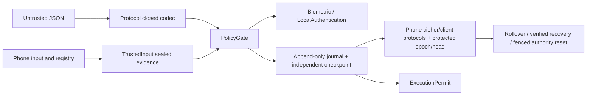

| Path | Content | Status |
|---|---|---|
| [Package.swift](Package.swift) | Policy + TrustedInput; only external dependency is sibling Protocol | ✅ Linux |
| [Sources/](Sources/README.md) | Deterministic gate, authentication, audit persistence and recovery | ✅ Unit tested; integration pending |
| [Tests/](Tests/README.md) | Schema-driven tool/tier matrix, cross-review regressions and recovery | ✅ Linux |
| [Security model](../../../../SYS/security-model.md) | Threat model, invariant → test map, integration assumptions | 🟡 Device and cross review pending |

Start with `PolicyGate.submit`: pass model JSON separately from trusted activation.
`approve` accepts an exact-preview phone event and obtains its own fresh authentication
for sensitive actions. Execution integrations accept `ExecutionPermit`, retain its
preview bytes and expiry, and deduplicate the command key at the side-effect boundary.
`prepare_send` remains a preparation operation; it does not add a send implementation.

Trace: [REQ-28–35, REQ-54–55, REQ-61](../../../../SYS/requirements.md).
No Brain/Stt import, platform frameworks needed on Linux, or UI implementation.

```sh
swift test -j 4 --package-path SW/ios/Packages/Policy
swift test -j 4 --package-path SW/ios/Packages/Policy --filter Gate
```

On hwgeekom prefix each command with `HEAVY_CPUS=4 heavy`. Tests use synthetic fixtures only.
Apple compilation, phone authentication, production AEAD/HTTP, secure checkpoint storage
and atomic app slot selection remain **unverified**. Archive/compaction behavior is tested
with synthetic adapters. Retention marks records due; verified copy-on-write compaction
keeps replay tombstones and the relay history. See the [archive contract](../../../../SYS/protocol/audit-archive.md). See the security model before app integration.

Cross-review hardening: risk cannot fall on edit; grants have per-risk TTL caps and durable revocation; dismissal/cancellation survive reconnect and restart. Explicit authenticated audit recovery preserves history and records clock correction. The Policy suite also enforces the TrustedInput import boundary in Brain/Stt and their Apple packages.

Router integrations use `PolicyGate.verifyExecution(command:immutablePreview:expiresAt:)` to check stored data against an actually issued live permit, exact command/preview/hash, expiry, revocation and audit integrity. Loading raw Codable commands never mints a permit. A new gate after restart requires reapproval; see `RoutingPermitGateTests`.

Archive integration: map fixed relay errors to `AuditArchiveFailure`, call scheduled verification even when idle, surface durable archive health, and supply an executor fence for explicit loss acceptance. See the [v2 contract](../../../../SYS/protocol/audit-archive.md). No permissive fence or production key/HTTP adapter is supplied.
