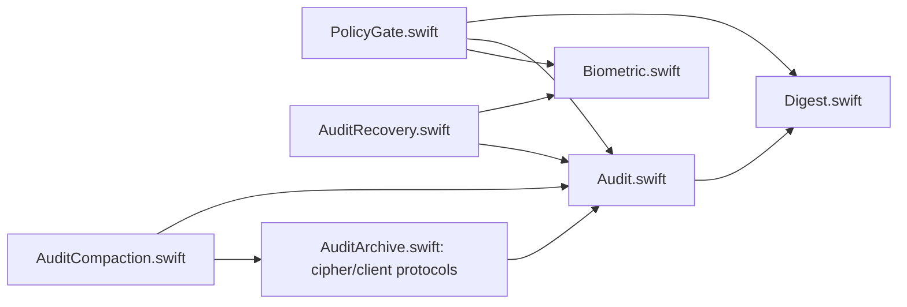

| File | Content | Status |
|---|---|---|
| [PolicyGate.swift](PolicyGate.swift) | Risk floors, bounded grants, durable revocation/dismissal, reconnect cancellation, payload-bound approval + live routing-permit verification | ✅ Linux tests |
| [Biometric.swift](Biometric.swift) | Challenge protocol and thin conditional Apple adapter | ✅ Fake tested; Apple **unverified** |
| [Audit.swift](Audit.swift) | Hash chain, exclusive append/sync journal, independent checkpoint + durable append intent, archive-age config | ✅ Linux file and corruption tests |
| [AuditAuthorityRecovery.swift](AuditAuthorityRecovery.swift) | Biometric loss acceptance, mandatory executor fencing, fresh session/domain and crash-safe new chain | ✅ synthetic tests; production fence unverified |
| [AuditArchive.swift](AuditArchive.swift) | Cipher/client protocols, padded staged replication, signed epoch rollover, scheduled read-back health and ciphertext fake | ✅ synthetic Linux tests; production adapters unverified |
| [AuditCompaction.swift](AuditCompaction.swift) | Checkpoint export and verified copy-on-write compaction preserving replay/ownership/revocation | ✅ Linux tests; app slot selection unverified |
| [AuditRecovery.swift](AuditRecovery.swift) | Authenticated crash/clock/archive recovery; preserves bytes, retires and binds migrated authority slots | ✅ Linux fault-injection tests |
| [Digest.swift](Digest.swift) | SHA-256 and exact preview encoding | ✅ Known-answer tests |

Start at `PolicyGate.submit`. All mutating services run on MainActor; authentication
rechecks state after suspension. Supply a trusted `AuditCheckpointStore`; there is no
unsafe default checkpoint reconstructed from the log. Trace: REQ-28–35, REQ-54–55.

Recovery requires a fresh biometric/passcode challenge and a new gate instance. Checkpoint adapters must persist both the head and exact pending append intent; there is no implicit reset or unexplained-tail acceptance.
