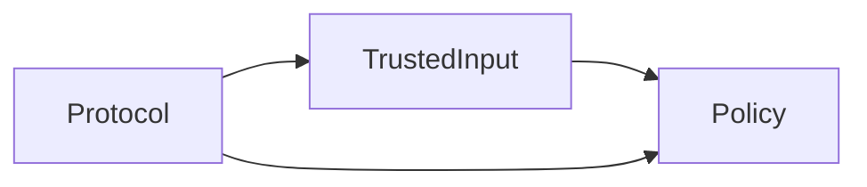

| Folder | Content | Status |
|---|---|---|
| [TrustedInput/](TrustedInput/README.md) | Phone-only evidence with explicit registry classification and grant issuance time | ✅ Linux tests |
| [Policy/](Policy/README.md) | Policy decisions, immutable previews, authentication, encrypted archive protocols, bounded compaction and explicit recovery | ✅ Linux tests |

Start with TrustedInput, then Policy. Trace: REQ-28–35, REQ-61.

Account binding and owner completion are local Policy contracts: `AuditLog(accountID:)` appends the migration event and wraps later records; `PolicyGate.confirmOwnerCompletion` validates the durable reservation and exact preview, then audits a fresh phone event. No wire authorization fields were added.
