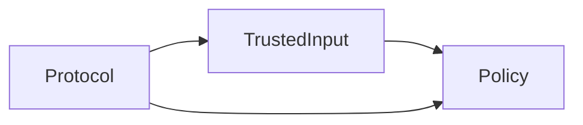

| Folder | Content | Status |
|---|---|---|
| [TrustedInput/](TrustedInput/README.md) | Phone-only evidence with explicit registry classification and grant issuance time | ✅ Linux tests |
| [Policy/](Policy/README.md) | Policy decisions, immutable previews, authentication, audit and explicit recovery | ✅ Linux tests |

Start with TrustedInput, then Policy. Trace: REQ-28–35, REQ-61.
