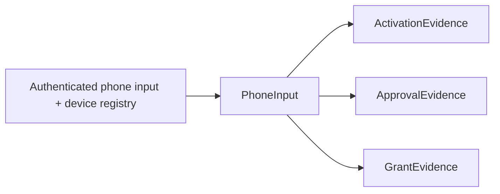

| File | Content | Status |
|---|---|---|
| [TrustedInput.swift](TrustedInput.swift) | Non-decodable immutable evidence with fileprivate constructors; trusted phone factory | ✅ Compile-boundary and gate tests |

Start at `PhoneInput`. Its methods are trusted integration entry points, never model tools.
Native app code can import this module; Swift visibility does not sandbox malicious app
code. Registry classification is required: unknown destinations deny. Grant evidence carries an immutable issuance timestamp. The Policy suite lints Brain, BrainApple, Stt and SttApple manifests/sources against TrustedInput references. Trace: REQ-30–33, REQ-61.
