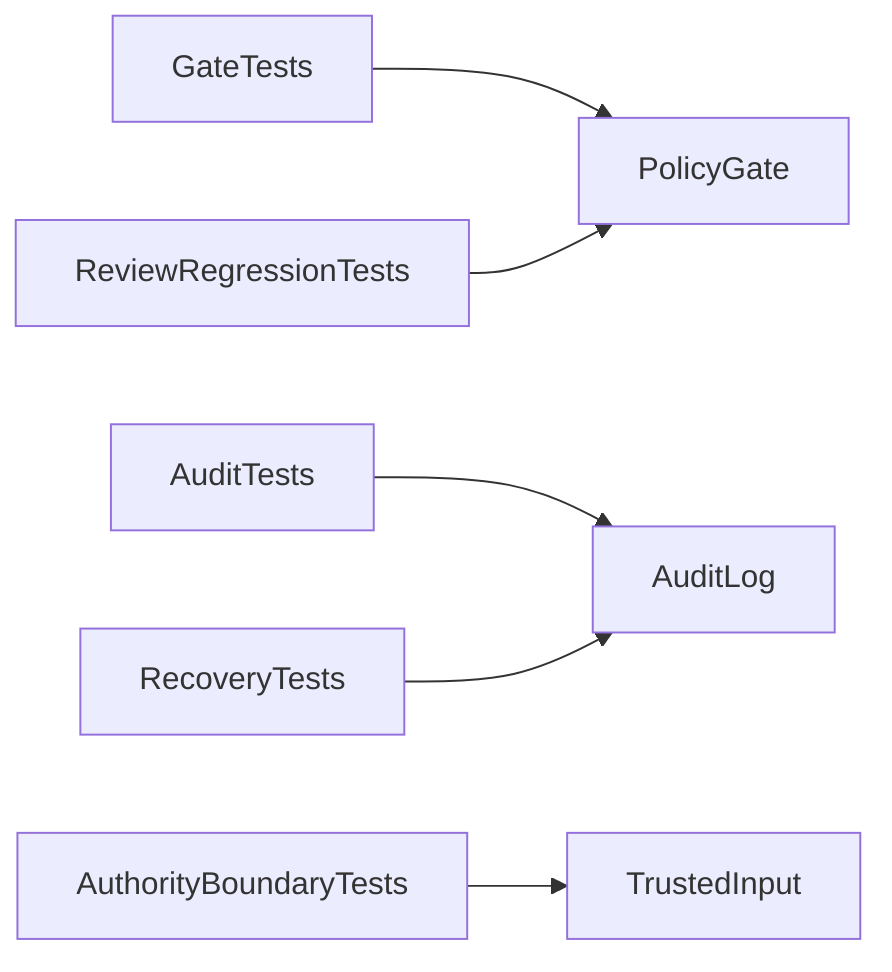

| File | Content | Status |
|---|---|---|
| [RoutingPermitTests.swift](RoutingPermitTests.swift) | Exact stored command/preview/hash/destination binding, revocation, expiry and gate restart | ✅ Linux |
| [GateTests.swift](GateTests.swift) | Every schema tool × tiers 1–3; injection, scope, expiry, races and replay | ✅ Synthetic Linux tests |
| [AuditTests.swift](AuditTests.swift) | SHA-256 vectors, tampering, crash failures, actual file reopen and locking | ✅ Linux |
| [AuthorityBoundaryTests.swift](AuthorityBoundaryTests.swift) | External swiftc invocation proves authority constructors/decoding are unavailable and registry kind is required; repository lint fixtures | ✅ Linux |

| [AuthorityImportLint.swift](AuthorityImportLint.swift) | Mechanical manifest/source boundary check for Brain, BrainApple, Stt, SttApple | ✅ Repository + injected violations |
| [ReviewRegressionTests.swift](ReviewRegressionTests.swift) | Cross-review risk, TTL, revocation, transition, registry, cancellation and dismissal regressions | ✅ Failed before fixes; pass after |
| [RecoveryTests.swift](RecoveryTests.swift) | Authenticated recovery, clock correction, tampering, partial writes, repeated crashes and races | ✅ Linux |

Start with `everySchemaToolEveryTierRequiresCorrectAuthority`. All suites contain `Gate`
in their name so the required scoped command includes every safety test. Test helpers
use fake time, memory checkpoints and authentication; the production Apple adapter is
**unverified** here. Trace: REQ-28–35, REQ-54–55, REQ-61.
