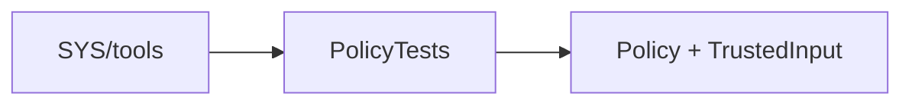

| Folder | Content | Status |
|---|---|---|
| [PolicyTests/](PolicyTests/README.md) | Portable authorization, encrypted archive verification/compaction/recovery, cross-review regressions and repository import lint | ✅ Linux |

Start with the schema-driven matrix. Run both commands in the package README.
Trace: REQ-28–35, REQ-54–55, REQ-61.

Account-envelope migration/archive regressions live in [PolicyTests/AuditTests.swift](PolicyTests/AuditTests.swift). Compiler-boundary tests also reject decoding owner completion evidence/receipts; production routing/phone-flow negatives live in AppModel.
