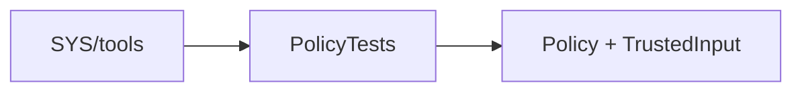

| Folder | Content | Status |
|---|---|---|
| [PolicyTests/](PolicyTests/README.md) | Portable authorization, recovery, cross-review regressions and repository import lint | ✅ Linux |

Start with the schema-driven matrix. Run both commands in the package README.
Trace: REQ-28–35, REQ-54–55, REQ-61.
