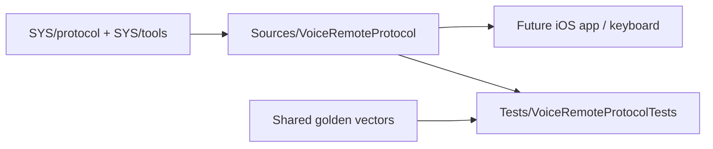

| File / folder | What it is | Status |
|---|---|---|
| [Package.swift](Package.swift) | Foundation-only Swift package; iOS 26 minimum, Linux testable | ✅ Linux |
| [Sources/](Sources/) | Generated Codable models, validation and wire codec | ✅ |
| [Tests/](Tests/) | Typed shared-vector round trips and rejection tests | ✅ |

Start with `import VoiceRemoteProtocol` and use
`ProtocolCodec.decode(InnerMessage.self, from: data)` / `ProtocolCodec.encode(value)`.
These codecs validate the wire contract; constructors are not authorization gates.

From the repo root:
`heavy swift test -j 4 --package-path SW/ios/Packages/Protocol --cache-path /tmp/voiceremote-protocol-swift-cache --manifest-cache local`.
Use `make -C SYS check` for codegen freshness and all three languages.
Edit [the schemas](../../../../SYS/protocol/README.md), then regenerate; do not
edit generated Swift. Trace: product §4/§7; requirements [REQ-59](../../../../SYS/requirements.md#extensibility) and [REQ-61](../../../../SYS/requirements.md#extensibility).
Apple app integration is **unverified**; this package has no Apple frameworks.

Wire codecs reject duplicate keys, nonliteral integers, invalid Unicode and control-bearing dictation before Foundation decoding.
