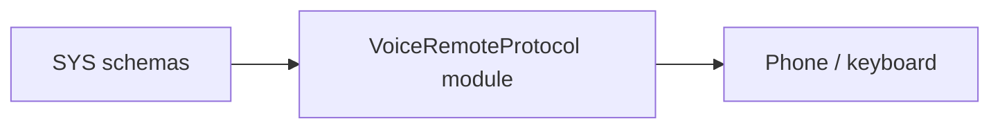

| Folder | What it is | Status |
|---|---|---|
| [VoiceRemoteProtocol/](VoiceRemoteProtocol/) | Generated wire contract and validation codecs | ✅ Linux |

Start with the module README and [package tests](../Tests/).
Trace: product §4/§7; numbered `[REQ-n]` is TBD.
