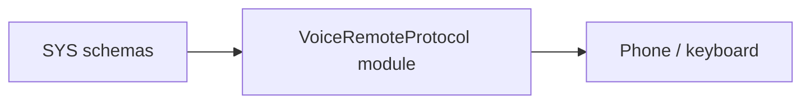

| Folder | What it is | Status |
|---|---|---|
| [VoiceRemoteProtocol/](VoiceRemoteProtocol/) | Generated wire contract and validation codecs | ✅ Linux |

Start with the module README and [package tests](../Tests/).
Trace: product §4/§7; requirements [REQ-59](../../../../../SYS/requirements.md#extensibility) and [REQ-61](../../../../../SYS/requirements.md#extensibility).

The module now validates raw JSON tokens before native decoding.
