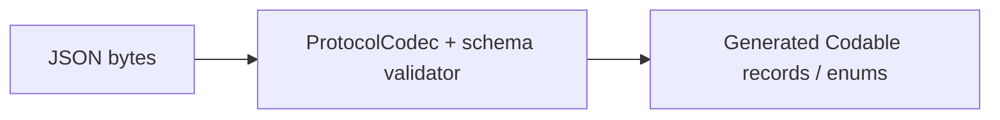

| File | What it is | Status |
|---|---|---|
| [Generated.swift](Generated.swift) | Typed records, unions, schema and scalar-validated codec | ✅ shared vectors |

Start with `ProtocolCodec`. Edit `SYS/codegen/templates/runtime.swift` or the
source schemas, then run `make -C SYS generate` and `make -C SYS check`.
Trace: product §4/§7; requirements [REQ-59](../../../../../../SYS/requirements.md#extensibility) and [REQ-61](../../../../../../SYS/requirements.md#extensibility). Policy and encryption are future work.

Wire parsing rejects duplicate decoded keys at every object depth and preserves integer token spelling.

Reviewed control/base64/hex patterns inspect `unicodeScalars` directly; no regex or grapheme
boundaries participate in validation. macOS 26 execution remains **unverified** pending CI.

Generated delivery/control messages and activity-age/listening fields come from SYS/protocol; round trips cover the new variants. Do not hand-edit Generated.swift.
