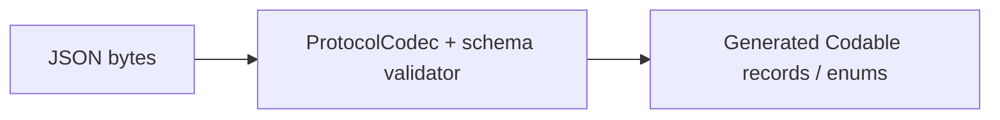

| File | What it is | Status |
|---|---|---|
| [Generated.swift](Generated.swift) | Typed records, unions, schema and validated codec | ✅ shared vectors |

Start with `ProtocolCodec`. Edit `SYS/codegen/templates/runtime.swift` or the
source schemas, then run `make -C SYS generate` and `make -C SYS check`.
Trace: product §4/§7; numbered `[REQ-n]` is TBD. Policy and encryption are future work.
