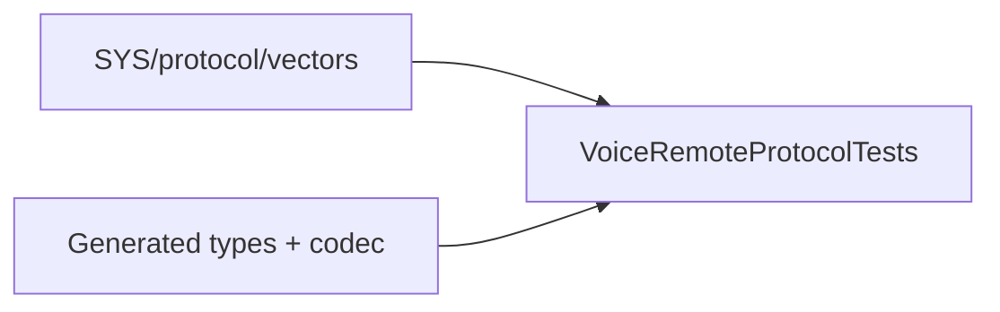

| Folder | What it is | Status |
|---|---|---|
| [VoiceRemoteProtocolTests/](VoiceRemoteProtocolTests/) | Shared compatibility and rejection tests | ✅ Linux |

Start with `RoundTripTests.swift`; run the package's `swift test` command.
Trace: product §4/§7; numbered `[REQ-n]` is TBD.
