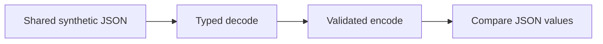

| File | What it is | Status |
|---|---|---|
| [RoundTripTests.swift](RoundTripTests.swift) | Valid/invalid shared vectors and constructed-value checks | ✅ Linux |

Start with the tests; the corpus is located relative to the source file, so run
from any directory in the checkout. Trace: product §4/§7; [REQ-59](../../../../../../SYS/requirements.md#extensibility), [REQ-61](../../../../../../SYS/requirements.md#extensibility).

Raw negative fixtures pass their original bytes through both public validation and typed decoding.
