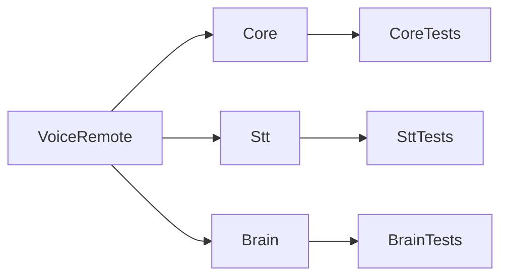

| Folder | What | Status |
|---|---|---|
| [Core](Core/README.md) | Display identity | ✅ Portable skeleton |
| [Stt](Stt/README.md) | Validated audio sample count | ✅ Portable skeleton |
| [Brain](Brain/README.md) | Explicit inference-engine availability | ✅ Portable skeleton |

Start with each `Package.swift`; run `swift test --package-path SW/ios/Packages/<name>`.
No Apple dependencies or Protocol dependency. No STT/brain accuracy or performance claims.
